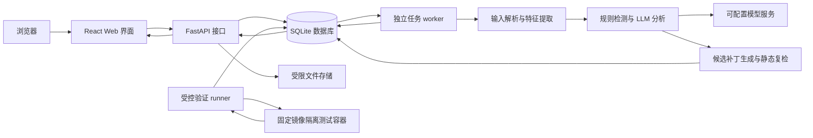

# AegisForge 项目实施与验收计划

版本：1.7 · 基线日期：2026-11-03 · 更新日期：2026-11-11 · 项目：铸盾 AegisForge

本计划是项目实施、GitHub 任务拆分、测试验收和课程报告的共同依据。目标是交付一个可在本地运行的 Web 系统，完成“输入代码或 HTTP 请求包 → 特征提取 → LLM 漏洞分析 → 结果展示 → 代码修复 → 修复验证 → 报告导出”的完整流程。修复及其验证列为必须完成的加分项。

M1 工程骨架已完成本地及 Windows/Linux GitHub CI 验收，证据见 [M1 验证记录](docs/m1-verification.md)与 [PR #9](https://github.com/visibychen/AegisForge/pull/9)。下文的最终性能、准确率和修复率均为验收目标，不是已经取得的结果。课程要求及评分映射见 [docs/requirements.md](docs/requirements.md)。

2026-11-04 追加 M1 科技流动视觉优化：Claude 主开发、Codex 审查，沿同一会话完成三轮，交付暗色控制台、连续装饰动效、可暂停/系统偏好优先控制和响应式细化，见 [协作记录](docs/collaboration-2026-11-04.md)与 [视觉验收](docs/m1-visual-verification.md)。按用户最新指示，本次只提交 M1 优化 PR 供审阅；**M2 暂缓且未开始**。

2026-11-05 用户恢复 M2，并授权 M3；两阶段各按“Codex 开发/Claude 审 → Claude 开发/Codex 审 → 讨论敲定、Claude 开发/Codex 审”协作三轮。真实模型验收经用户选择延后，不能将离线替身测试写成真实模型通过。当前进展与异常恢复见 [本次协作记录](docs/collaboration-2026-11-05.md)。上段暂缓状态为历史记录。

用户随后收窄为只完成 M2，M3 暂缓。M2 已完成三轮协作、上传/解析/脱敏/规则及最小输入页，冻结 120 源码/60 HTTP 的家族划分与哈希，预登记 18 个受控修复例。本地 143 后端通过、1 平台跳过、14 前端及 2 浏览器场景通过；见 [M2 验证记录](docs/m2-verification.md)。PR 集成与人工标注复核仍待完成，不以此代替 M6 准确率或 M4 动态验证。

## 1. 目标与范围

2026-11-07 用户恢复 M3，指定 DeepSeek API，密钥只存环境变量。本轮分工为：第一轮 Codex 开发/Claude 审，第二轮 Claude 优化/Codex 审，第三阶段多次真实讨论后由 Codex 最终优化。每轮审查从第二阶段起还需提出功能创新。当前 M3 已完成开发和本地验收，待 PR 集成；同会话四次真实调用，后两次为第三阶段讨论。覆盖账本、检测凭证及证据失败分类已落实；三类 DeepSeek 开发例均通过。见 [M3 设计](docs/m3-design.md)、[验证记录](docs/m3-verification.md)和[协作记录](docs/collaboration-2026-11-07.md)。

2026-11-08 M4实现与本地验收完成，待PR集成：按Codex开发/Claude审、Claude优化/Codex审、双方多次讨论/Codex最终优化推进；每次审核须提出创新，Claude固定Sonnet5.5 high。现行范围见[M4设计](docs/m4-design.md)，执行与实际证据见[协作记录](docs/collaboration-2026-11-08.md)。

### 1.1 必须交付的功能

| 编号 | 功能 | 实施范围 | 验收证据 |
| --- | --- | --- | --- |
| R01 | Web 输入与上传 | 上传代码文件、原始 HTTP/1.x 请求文本；提供示例输入与输入预览 | 上传、校验、错误反馈及浏览器端到端测试 |
| R02 | 特征提取 | Python AST、危险函数、输入来源、输出位置、规则线索；HTTP 路径、参数、请求头及正文特征 | 特征单元测试、提取结果与行号 |
| R03 | LLM 智能检测 | XSS、SQL 注入、OS 命令注入/执行风险，分别对应 CWE-79、CWE-89、CWE-78 | 真实模型评测、结构化输出、三类演示案例 |
| R04 | 检测结果展示 | 漏洞类型、风险等级、证据位置、形成原因、修复建议、检测来源与局限 | 详情页、代码定位、风险汇总、筛选 |
| R05 | 代码修复【加分必做】 | 对受支持源码生成候选修复代码及 unified diff，支持预览与下载 | 三类漏洞的补丁生成、差异展示、补丁应用测试 |
| R06 | 修复验证【加分必做】 | 语法/补丁检查、规则与 LLM 复检；受控样例增加安全回归和正常功能测试 | 修复前后对比、验证记录、通过/失败/未验证状态 |
| R07 | 历史与导出 | 检测记录、修复记录、脱敏 JSON/Markdown 报告下载 | 重启持久化、关联查询、导出完整性测试 |
| R08 | 工程交付 | 可复现环境、配置样例、完整源码、自动化测试、设计报告与实现报告 | 干净环境部署、CI、使用截图与报告 |

P0 为以上全部功能以及本计划要求的测试与文档。P1 为核心交付后可做的增强：JavaScript/HTML 的 XSS 分析、更多语言与漏洞类型、SARIF 导出、更多可视化。P1 不得替代或推迟 R05/R06。

### 1.2 能力边界

1. 首版以 **Python 3 / Flask 风格 Web 源码**为完整检测与修复支持范围；三类必做漏洞都须有源码正例、安全反例和可运行的受控验证样例。
2. HTTP 输入为离线请求文本分析，不扫描站点、不重放请求。仅凭请求中的攻击载荷只能判定攻击特征或潜在风险，不能证明服务端存在漏洞。
3. HTTP 结果可以提供防护建议；缺少源码时返回 `source_required`，不生成虚构的源码补丁。用户可将源码关联到同一任务后再申请修复。
4. 任意上传源码只做静态分析和候选补丁生成，不在 API/worker 主机执行。动态验证只覆盖仓库登记的受控样例，且在隔离环境运行。
5. 首版为本地单用户课程演示系统，默认绑定回环地址。公网多租户、账号体系、GitHub 自动改代码、ZIP/PCAP 上传和任意项目依赖安装不在首版范围。
6. 普通 CI 使用模拟模型；最终验收必须另有真实 LLM 的检测、修复及评测证据。离线演示清楚标记模拟模式。

## 2. 系统框架与技术选型

### 2.1 总体架构

采用一个仓库管理前后端，后端为模块化单体，并将耗时任务放入独立 worker。首版不引入 Redis/Celery，降低课程演示的部署依赖；任务状态通过数据库持久化。



验证 runner 与 API/worker 分开启动，只接受固定样例标识和候选补丁快照。Docker 管理权限仅属于本地受信 runner；API、worker 和测试容器不持有 Docker socket。图中的数据库访问均通过内部服务约束，浏览器不直接接触数据库。

### 2.2 选型基线

| 层次 | 选型 | 选择原因与约束 |
| --- | --- | --- |
| 前端 | React + TypeScript + Vite | 组件化实现任务、漏洞和修复页面；类型约束接口数据 |
| 界面 | Ant Design；Monaco Editor 按需加载 | 提供表格、表单、状态反馈和代码差异查看；风险分布优先用简单图表，避免重型看板先行 |
| API | Python 3.13 + FastAPI + Pydantic | 类型化请求、输出校验、OpenAPI 接口文档 |
| 数据 | SQLAlchemy + Alembic + SQLite | 关系数据和迁移可追踪；首版单 worker，启用外键与合适的锁等待/WAL 配置 |
| 任务 | 数据库作业表 + 独立 worker | 保存状态、重试次数、租约与心跳；API 进程重启不应使任务静默消失 |
| 模型 | Provider 接口 + HTTP 客户端 + fake provider | 固定 DeepSeek HTTPS 地址，环境变量配置模型，OS 环境变量独占密钥；真实服务与测试替身可替换，不依赖前端密钥 |
| 规则 | Python AST + 版本化规则集 | 形成可解释的来源、危险操作和行号线索，不宣称完整污点分析 |
| 修复 | 结构化编辑操作 + 服务端生成 diff | 基于不可变源码快照验证编辑范围，再生成可下载补丁 |
| 验证 | pytest + 固定受控样例 + Docker Linux 容器 | 将语法、复检、漏洞回归和业务回归分层记录 |
| 质量 | Ruff、pytest、Vitest、Testing Library、Playwright | 分别覆盖后端、前端行为和浏览器业务流程 |
| 部署 | Windows 本地开发；Docker Compose 演示配置 | 本机基础检测不强制依赖 Docker；正式动态验证必须在 Docker 可用的环境验收 |
| 协作 | Git + GitHub Issues / PR / Actions / Releases | 计划编号关联需求、代码、测试与提交 |

运行时基线为 Python 3.13 与 Node.js 24.x。按用户要求，Python 统一使用 Anaconda/conda 的 `AegisForge` 环境，`environment.yml` 声明运行时；项目库通过该环境中的 `python -m pip` 管理并提交精确版本锁，不再使用 uv 环境或 uv.lock。M1 验证依赖兼容性并提交 npm 锁文件。依赖选择受支持且兼容的稳定版本；不使用浮动 `latest` 作为可复现交付依据。决策见 [ADR 0001](docs/decisions/0001-anaconda.md)。选型参考见第 13 节。

### 2.3 计划目录结构

```text
AegisForge/
├── PLAN.md                       # 本计划和里程碑状态
├── AGENTS.md                     # 后续实施的目录与计划约束
├── AGENT.md                      # 用户指定的环境约定入口
├── environment.yml               # Anaconda/conda 运行时声明
├── README.md                     # 定位、入口、实际可用状态和启动说明
├── CONTRIBUTING.md               # Git / GitHub 工作流
├── .github/
│   ├── ISSUE_TEMPLATE/
│   ├── pull_request_template.md
│   └── workflows/                # M1 起建立 CI，随实现扩展
├── frontend/
│   ├── src/{pages,components,api,types}/
│   ├── tests/                    # 含同包管理的浏览器 e2e
│   └── package-lock.json
├── backend/
│   ├── app/
│   │   ├── api/                  # 接口与错误响应
│   │   ├── core/                 # 配置、存储、脱敏与日志
│   │   ├── models/               # 数据库实体
│   │   ├── schemas/              # 输入输出协议
│   │   ├── parsers/              # Python 与 HTTP 解析
│   │   ├── rules/                # 版本化规则与提取器
│   │   ├── llm/                  # Provider、提示词和 JSON 校验
│   │   ├── services/             # 检测、修复、验证、导出
│   │   └── worker/               # 作业领取、执行与恢复
│   ├── migrations/
│   ├── tests/{unit,integration,security}/
│   ├── pyproject.toml
│   ├── requirements.lock          # 运行库精确版本
│   └── requirements-dev.lock      # 开发/测试库精确版本
├── samples/{source,http,controlled}/
├── evaluation/                   # 标注、划分清单、评测程序与结果摘要
├── scripts/                      # 启动、评测和受控验证入口
├── deploy/                       # Compose、Dockerfile 与固定镜像清单
└── docs/
    ├── requirements.md
    ├── design.md
    ├── decisions/                # 架构决策记录
    ├── test-report.md
    ├── user-guide.md
    ├── reports/                  # 详细设计与实现报告源稿
    └── screenshots/
```

本目录树是目标结构；M0 不预建没有实现的空模块。运行数据统一放在被 Git 忽略的 `data/`，不提交上传内容、真实请求凭据、密钥或原始模型日志。

## 3. 模块设计与业务流程

### 3.1 输入接入与特征提取

- 源码首版接受 `.py`；HTTP 接受 `.http`、`.req`、`.txt`，必须显式选择输入类型并验证内容。后缀与 Content-Type 均不能单独作为可信判断。
- 默认单文件上限 2 MiB、单任务最多 10 个文件、总计不超过 10 MiB；拒绝空内容、二进制、压缩包、非支持编码及路径穿越。文件用随机 ID 保存，原始名称仅用于展示。
- 保留原始行号、内容哈希、解析器版本；使用 UTF-8，可识别 UTF-8 BOM；其他编码明确报错而非错误解码。
- Python AST 提取输入来源、危险调用、字符串拼接、HTML 输出、SQL 执行及子进程调用；解析失败仍可展示文本级线索，但标记分析能力受限。
- HTTP 解析方法、URL、查询参数、头部及常见正文；解码有次数和大小上限，保留原始/规范化位置。Authorization、Cookie、常见 API key 在模型发送、展示导出与日志前脱敏。
- 代码内容按函数/行边界分块并保留上下文映射。默认每块最多 12,000 字符，重叠不超过 1,000 字符，每任务最多 8 块、规范化内容最多 80,000 字符；超预算任务在模型调用前拒绝并提示缩小输入，不静默截断后宣布“无漏洞”。

### 3.2 检测流水线

1. 校验输入和预算，创建不可变快照与任务。
2. 提取语言特征，运行规则，保留候选证据和规则依据。
3. 按已登记策略构建提示词，对全部预算内分块调用模型；不能只扫描规则命中内容而漏掉无规则线索的代码。
4. 用 Pydantic 校验输出，包括漏洞类别、等级、证据、建议和位置；核实行号及证据确实存在于输入，禁止模型伪造文件路径和位置。
5. 合并同文件、同 CWE、重叠位置的重复发现；保留规则与 LLM 各自来源，不能以去重删除冲突信息。
6. 落库并展示结果。模型失败时可以展示规则结果，但任务标为 `partial` 并注明 LLM 未完成，不得伪装成完整智能检测成功。

风险等级统一为 `critical/high/medium/low/info`；严重性由规则化标准与证据共同确定，自报置信度单独展示且不作为校准概率。源码结果区分 `potential` 与具备受控验证证据的 `verified`；HTTP 结果固定为 `attack_indicator` 或 `potential`。

Provider 接口支持真实模式与 fake 模式。模型地址和密钥只由后端配置；页面可以选择服务器登记的模型别名，不接收任意远程地址。输出须遵循版本化 JSON schema；超时、限流、无效 JSON 和输出超限均可追踪。网络/限流至多重试 2 次，无效结构至多纠正 1 次，并受总调用预算限制。

### 3.3 修复与验证流水线

1. 用户选择源码漏洞申请修复；固定原始文件哈希、漏洞记录和模型配置。
2. 模型返回编辑范围、替换文本与解释；后端检查边界、重叠、原文匹配和修改大小，从原始快照生成候选文件及 unified diff。
3. 候选文件与原始文件分别保存，原始上传不被覆盖；下载补丁不修改用户 Git 仓库。
4. 校验补丁可应用性、Python 语法和目标规则变化；再次进行 LLM 检测，显示修复前后发现变化及新增风险。
5. 对登记的受控样例，由独立 runner 在固定镜像中执行冻结的安全回归测试与业务回归测试。测试与标准答案不发送给修复模型，候选补丁不能改测试、依赖或容器配置。
6. 保存每一步结果、耗时、日志摘要和候选哈希，允许预览、下载和发起新候选版本；初版一次申请只产生一个候选，不无限自动自修复。

验证结论必须区分：`passed`（预定全部检查通过）、`failed`（至少一项失败）、`unverified`（缺乏动态证据）、`error`（验证环境或工具失败）。普通上传即使语法与复检通过，也只能表示“静态检查通过，运行时效果未验证”。受控样例的 `passed` 也仅表示本次测试集通过，不等于已证明没有其他漏洞。

### 3.4 页面与交互

| 页面 | 必须呈现的内容 |
| --- | --- |
| 总览 | 任务数、漏洞类型/等级分布、最近任务、真实/模拟模式提示 |
| 新建检测 | 输入类型、上传/粘贴、示例、脱敏预览、模型别名、范围与预算提示 |
| 任务详情 | 阶段、耗时、错误、分析范围、漏洞列表与筛选；失败可重试 |
| 漏洞详情 | 类型、CWE、等级、输入证据、行号高亮、原因和修复建议 |
| 修复工作台 | 原始/候选代码对比、补丁下载、每项验证状态、前后风险变化 |
| 历史记录 | 查询、分页、查看、逻辑移出（保留预算/输入）、JSON/Markdown 导出；物理快照擦除另行设计 |

轮询查询任务进度作为首版机制；页面刷新后可恢复任务查看。处理加载、空结果、部分成功、超时、无模型配置和无 Docker 等状态。代码、HTTP 文本和模型内容统一按不可信文本渲染，禁止直接插入未经处理的 HTML。

## 4. 数据与接口设计基线

### 4.1 数据实体

| 实体 | 核心字段与关系 |
| --- | --- |
| Artifact | UUID、输入类型、语言、展示名、私有存储键、SHA-256、大小、创建时间 |
| ScanTask / TaskArtifact | 任务状态、输入关联、策略、模型别名、规则/提示词版本、时间、错误、分析范围 |
| Job | 类型、关联任务/修复、状态、尝试次数、租约、心跳、幂等键、取消请求 |
| Finding | 关联任务与文件、CWE、类别、等级、证据、起止行/HTTP 字段、来源、证据状态 |
| Repair | 关联漏洞、基础/候选哈希、结构化编辑、diff、生成状态、模型版本与解释 |
| Validation | 关联修复、检查类型、样例版本、状态、耗时、通过数/总数、脱敏证据 |
| ModelCall | 关联作业、provider/model、输入/输出 token、耗时、重试、脱敏错误，不存明文密钥 |

源码任务可含多个文件；HTTP 输入可关联后续补充的源码。数据库启用外键，删除任务时遵循明确的关联清理策略；文件引用数归零后才回收快照。数据库保存 UTC 时间，界面按 Asia/Shanghai 显示。

### 4.2 接口清单

所有业务接口以 `/api/v1` 为前缀，响应统一包含 `request_id`，错误包含稳定错误码。UUID 是标识符，不作为鉴权手段。

| 方法与路径 | 用途 |
| --- | --- |
| `GET /health` | 存活检查，不泄露密钥和完整系统配置 |
| `POST /artifacts` | 上传并校验源码/HTTP 输入，返回快照 ID |
| `POST /scans` | 指定输入和策略创建任务，返回 202 与任务 ID |
| `GET /scans`、`GET /scans/{id}` | 分页历史与任务进度 |
| `GET /scans/{id}/findings` | 漏洞筛选、详情关联及来源 |
| `POST /scans/{id}/cancel`、`POST /scans/{id}/retry` | 尽力取消与有上限的重试 |
| `POST /findings/{id}/repairs` | 创建候选修复；无源码返回 `SOURCE_REQUIRED` |
| `GET /repairs/{id}`、`GET /repairs/{id}/diff` | 候选信息、差异与下载 |
| `POST /repairs/{id}/validations` | 创建静态验证或登记样例动态验证任务 |
| `GET /repairs/{id}/validations` | 验证步骤与证据 |
| `GET /scans/{id}/export?format=json\|markdown` | 脱敏导出 |
| `DELETE /scans/{id}` | 删除非运行任务和可回收数据 |
| `GET /capabilities` | 支持语言、大小上限、模型模式、验证可用性，不返回凭据 |

检测任务状态为 `queued → running → completed/partial/failed/cancelled`。修复生成与验证分别管理状态，不能用“补丁生成成功”代替“验证通过”。作业领取使用原子状态变更与租约；首版一个 worker，每次执行一个作业，队列上限默认 10。服务重启后过期租约可恢复或明确失败；外部调用可能重复，必须计入日志与预算，不能承诺绝对只调用一次。

## 5. 系统自身的安全设计

- 上传文件保存在 Web 静态目录之外，通过受控下载接口读取；路径由内部 ID 构造。防范路径穿越、符号链接、HTML 执行、超大内容和解析耗时异常。
- 首版使用后端配置的共享访问令牌保护业务 API，浏览器会话输入令牌；不把令牌编译进前端包。限制 CORS 来源，默认回环监听，并对模型调用与任务创建限速。
- 源码、注释和 HTTP 参数都是待分析数据。提示词明确数据边界；模型不拥有文件、终端、网络抓取或 GitHub 写入工具。服务端做结构校验与权限检查，不把提示词防护描述为绝对可靠。
- 密钥只读自后端环境；日志、导出、截图、错误响应不得包含密钥、完整 Cookie 或 Authorization。`.env.example` 只含占位值。
- 模型 endpoint 由本地管理员配置，禁止从上传文件、请求参数或模型结果推导 URL，以减少 SSRF 风险。HTTP 输入始终不主动联网。
- 动态验证使用固定镜像、固定入口、非 root 用户、只读根文件系统、临时可写目录、禁外网、移除 capabilities、no-new-privileges，设置 CPU/内存/PID/磁盘输出/超时限制。预算为 1 CPU、512 MiB、每例宿主 30 秒/driver 25 秒；SQLi/CMDi 64 PID，XSS按实测调为128 PID，见 ADR 0003。
- 测试容器没有源码仓库写权限、宿主目录挂载、密钥和 Docker socket。受控文件通过受限快照送入；网络仅允许容器内部 loopback。验证异常必须中止并回收容器。
- Docker 是课程实验的隔离措施，不能宣称为执行任意敌意代码提供完整安全保证；本项目因此限制为登记样例。无 Docker 时保留静态功能并标注动态验证不可用，最终验收仍须完成受控动态测试。

## 6. 分阶段实施与交付

估算合计 18–27 个有效工作日，仅用于排期，不代表承诺日期。每阶段先交付可演示的纵向功能，再完善边界。总跟踪为 [GitHub Issue #1](https://github.com/visibychen/AegisForge/issues/1)，阶段任务如下。

| 阶段 | 状态 | 依赖 | 交付与完成条件 | 估算 | GitHub Issue |
| --- | --- | --- | --- | --- | --- |
| M0 计划与管理基线 | 已完成 | 无 | PLAN、需求评分映射、协作规范、任务拆分；首个 Git 提交与远端同步 | 本次 | [#1](https://github.com/visibychen/AegisForge/issues/1) |
| M1 工程骨架与协议 | 已完成 | M0 | Anaconda AegisForge 环境、前后端最小启动、依赖锁定、迁移、健康检查、任务/输出 schema、界面骨架、fake provider、基础 CI；提交设计初稿 | 2–3 日 | [#2](https://github.com/visibychen/AegisForge/issues/2) |
| M2 输入与特征提取 | 实现及本地验收完成，待PR集成；人工复核已完成，1项分类分歧待处置 | M1 | 上传/HTTP/Python 解析、快照存储、三类规则、脱敏与限制；开发样例与保留集冻结；详见 M2 验证记录 | 2–3 日 | [#3](https://github.com/visibychen/AegisForge/issues/3) |
| M3 智能检测闭环 | 实现及本地验收完成，待 PR 集成 | M2 | DeepSeek/fake provider、独立 worker、schema 校验、合并与部分失败、结果接口与最小结果页、覆盖账本/检测凭证；三类真实模型开发演示已通过 | 3–4 日 | [#4](https://github.com/visibychen/AegisForge/issues/4) |
| M4 修复与验证闭环 | 实现及本地验收完成，待 PR 集成 | M3 | 候选补丁、diff、静态与 LLM 复检、受控 runner；三类各至少一个漏洞从检测到安全/业务回归通过的完整演示 | 4–6 日 | [#5](https://github.com/visibychen/AegisForge/issues/5) |
| M5 完整 Web 集成 | 实现及开发验收完成，PR #15 待集成；见 M5 记录与 Issue #6 | M3，修复页依赖 M4 | 所有页面、筛选统计、历史、导出、异常体验；核心浏览器 E2E 全通过 | 2–3 日 | [#6](https://github.com/visibychen/AegisForge/issues/6) |
| M6 全面测试与实验 | 全量实验及三轮优化完成，正式数值门槛未过；人工复核完成、4项分歧待处置，PR #16待审 | M4、M5 | 756检测任务、54次首次修复、性能/资源/兼容及事后开发诊断；详见测试报告，不回填失败 | 3–5 日 | [#7](https://github.com/visibychen/AegisForge/issues/7) |
| M7 报告与发布验收 | 未开始 | M6 | 详细设计及实现报告、截图、使用说明、查重报告、发布包、v1.0.0；满足第 10 节 | 2–3 日 | [#8](https://github.com/visibychen/AegisForge/issues/8) |

阶段推进规则：完成条件和证据齐备才勾选完成；仅有代码或模拟结果不算通过。阶段内可交叉完善 UI 与测试，依赖阶段未验收时不得标记后续阶段完成。每阶段更新需求追踪矩阵以及本表状态。

## 7. 最终测试方案

测试随开发建立，M6 运行完整验收矩阵。使用独立临时数据库和合成样例；普通 CI 不调用付费模型、不提交业务数据、不主动扫描外部网站。

### 7.1 测试层次与典型用例

| 测试层次 | 重点用例 | 预期与证据 |
| --- | --- | --- |
| 单元测试 | AST/HTTP 解析、编码、解码上限、行号、规则、脱敏、JSON 校验、diff | 正反例与边界输出符合预期；报告不能仅测试函数存在 |
| API/集成 | 上传→队列→分析→保存→查询→修复→验证→导出；迁移和删除 | 任务与数据一致，接口状态码和错误码稳定 |
| 模型适配 | 超时、429、5xx、非 JSON、缺字段、伪造路径/行号、超长输出 | 有上限的重试和错误；不以空结果吞掉失败 |
| 任务可靠性 | 重启、租约过期、重复领取、重复修复申请、取消、队列满 | 没有静默丢失和无限重试；终态及费用记录可解释 |
| 浏览器 E2E | 三类源码检测修复、HTTP 风险分析、刷新恢复、筛选、下载、无密钥/无 Docker | 页面与后端一致，关键流程可操作，差异与证据可读 |
| 应用安全 | 未授权调用、路径穿越、二进制、超限、XSS 渲染、提示注入、秘密泄漏、任意 endpoint | 在本地测试环境验证拒绝/转义/脱敏，报告不泄漏数据 |
| 沙箱安全 | 外网访问、文件越界、超时、内存/PID/输出上限、容器回收 | 固定约束生效；API 无 Docker 权限；验证错误不记为通过 |
| 兼容与部署 | Windows 本地、Linux Compose；Chromium 全 E2E，Firefox 核心冒烟 | 干净克隆按说明可启动；无开发机私有路径依赖 |
| 性能与预算 | 10 个任务提交、轮询、5 个连续模型任务、模型调用预算触发 | 分离排队/解析/模型/验证耗时；记录 p50/p95、错误率、token |
| 依赖检查 | Python/npm 已知漏洞扫描及锁文件完整性 | 影响部署的高危/严重依赖问题需修复或提供有依据的处置记录 |

### 7.2 数据集与划分

源码检测集目标 **120 例**：XSS、SQL 注入、命令注入各 20 个漏洞例和 20 个对应安全例。按样例家族划分开发集 48 例、保留测试集 72 例；每类开发集 8 正/8 负，测试集 12 正/12 负。

HTTP 分析集目标 **60 例**：三类攻击特征各 10 例，正常请求 30 例。开发集 24 例（三类各 4 个攻击特征及 12 个正常例），测试集 36 例（三类各 6 个攻击特征及 18 个正常例）。HTTP 标签只评价攻击特征识别，不与源码漏洞存在性混算。

从源码测试集预先登记 **18 个受控可运行漏洞样例**（每类 6 个）用于修复实验；每个样例有正常输入、安全回归断言和人工参考修复。它们同时属于检测测试集，统计时不得当成新增独立样本。

每例记录 ID、来源/许可、输入哈希、语言、标签、CWE、漏洞行范围、家族 ID、划分、标注依据与人工核对记录。安全/漏洞配对、等价变体以及同一源码派生 HTTP 请求必须在同一划分，避免泄漏。人工编写样例可复用，第三方样例保留许可。

M2 冻结划分清单与测试标签，M3/M4 调整规则和提示词只用开发集；正式实验不得把测试标签、参考修复或隐藏测试交给模型。测试后若据结果调优，该测试集转为开发用途，并建立新的保留集或明确报告偏差，不能继续宣称独立评测。

### 7.3 检测实验与指标

在同一保留集比较 **规则单独检测、LLM 单独检测、规则 + LLM 联合检测**。规则模式不调用模型；LLM 模式保留相同预处理但不提供规则提示；联合模式包含规则证据。模型、分块、预算和其他配置一致，记录差异。

- 源码发现按“文件/样例 ID + CWE + 与标注区间有交集”匹配，每个标注最多匹配一次；额外重复或无关发现计 FP。安全例有发现计误报。
- 计算 `Precision=TP/(TP+FP)`、`Recall=TP/(TP+FN)`、`F1=2PR/(P+R)`，报告每类与 micro/macro 汇总，以及安全例误报率、任务失败率和耗时。零分母标记 N/A 并说明。
- 真模型模式至少重复 3 次，固定提示词/规则版本，记录 provider、model、参数、时间和每次原始统计，报告均值与范围。规则基线结果可复用确定性运行，不伪造模型确定性。
- 源码联合模式目标：micro Precision ≥ 0.85、micro Recall ≥ 0.85、每类 Recall ≥ 0.80；给出实际整数 TP/FP/FN，不能用四舍五入掩盖未达标。
- HTTP 单独报告攻击特征 Precision/Recall/F1，目标 micro F1 ≥ 0.85，并展示“正常请求无报警、攻击载荷提示潜在风险”的边界。
- 超时、解析失败、模型拒绝等保留在端到端分母中；正例未产出发现计 FN，并另报故障率。成功子集可以补充分析，但不得替代全量结果。
- 真实评测需先配置服务及调用预算；程序提供 dry-run、预计调用数、请求/token 上限和断点记录。达到预算即中止并标记评测未完成，不静默换模型、用假结果补齐或无限重试。

检测阈值以 3 轮指标的算术平均值判定，同时列出每一轮结果和跨轮累计整数统计；不得只选择最佳一轮。规则基线执行一次确定性评测即可。

指标目标服务于课程受控评测，不推断为真实互联网项目上的保证。若不达标，应通过开发集改进并重新评测；时间或资源不足时如实报告缺口，不降低阈值后回填“通过”。

### 7.4 修复实验与有效性判据

每个受控样例首先验证：原始版本可复现目标问题、正常功能可用；人工参考修复能通过既定安全与业务测试。基线失败的样例在正式实验前修正，不能在看到模型结果后选择性剔除。

| 类型 | 修复前验证 | 修复后安全断言 | 正常功能回归 |
| --- | --- | --- | --- |
| XSS | 容器内浏览器在本地测试页执行无害标记脚本 | 同样输入不能触发脚本，按预期作为文本/安全内容展示 | 普通文本、特殊字符和合法输出行为保持 |
| SQL 注入 | 临时 SQLite 样例中，攻击输入影响查询语义或越权读取合成数据 | 同样输入不能越过既定查询边界 | 合法查询、空结果和引号输入处理正确 |
| 命令注入 | 容器临时目录内出现无害测试标记 | 同样输入不能触发额外命令或标记 | 预定合法参数和原有功能保持 |

修复成功必须同时满足：候选可应用、语法正确、安全测试全过、业务测试全过，且无复检发现的新增 high/critical 风险。LLM 认为“已修复”只是一项复检信息，不能替代动态证据。

18 个样例全部进入端到端实验，未检测到、生成失败、验证失败或验证缺失均不算修复成功。报告 `成功样例数/18`，同时补充“已正确检测样例中的生成率、可应用率、动态通过率”，防止只统计成功补丁。

目标为至少 **15/18** 样例达到完整成功判据，且每类至少 **4/6**。首次候选通过率为主指标；如展示人工选择的后续候选，须另列尝试次数、人工介入和成本。真实模型至少运行 3 轮，报告各轮整数结果及平均值；最终按三轮总成功数至少 45/54、每类至少 12/18 判定，不单独挑选最好一轮。

### 7.5 性能、资源与质量门槛

- 在报告注明 CPU、内存、OS、部署方式、样例规模、模型配置及网络条件。非模型 API 在本地 10 并发请求、100 次请求的测试中目标 p95 < 500 ms、非预期错误为 0；使用 fake provider，避免外部模型延迟污染接口指标。
- 对不超过 50 KiB 的单个源码任务，真实检测目标服务时间 ≤ 120 秒（不含排队），单次模型调用超时默认 60 秒、任务总时限默认 180 秒；超限必须终止并显示失败/部分结果。实际受 provider 和重试影响，记录达标率而非隐藏超时。
- 分别统计上传校验、排队、解析、LLM、修复和验证耗时；记录 token 使用，费用仅在 provider 给出依据时估算，缺失记 N/A。
- 后端核心服务/解析/规则/修复模块分支覆盖率目标 ≥ 80%；覆盖率作为辅助信号，关键安全与业务断言必须全部通过，不为纯样式和简单可逆文档修改编写机械测试。
- P0 功能用例及核心 E2E 全部通过；无未解决的阻断/严重缺陷。中低等级问题写入 Issues 和发布说明。

### 7.6 执行入口与结果归档

M1–M6 逐步提供以下统一命令接口。M1 已实现 `scripts/check.py` 和前端连接冒烟 E2E，其余评测、样例动态验证与总验收脚本仍为后续约定。所有 Python 命令均在 Anaconda AegisForge 环境执行，README 随实际实现更新。

```text
python scripts/check.py             # 已实现检查项的统一入口：格式、类型、单元与集成
python scripts/evaluate.py --help   # 数据集校验、dry-run、三种检测策略及真实模型评测
python scripts/validate_samples.py --help  # 固定样例动态验证与隔离检查
python scripts/acceptance.py        # 已实现核心实验严格门禁；其他矩阵项明确不在重算范围
npm --prefix frontend run test:e2e  # 浏览器业务流程
```

每次正式实验记录代码 SHA、运行时/依赖锁哈希、数据清单哈希、规则/提示词版本、模型与参数、时间、机器、预算、随机种子（若服务支持）及失败明细。保存脱敏 JSON/CSV、混淆统计、修复日志、CI 报告和关键截图。版本化结果摘要在 `evaluation/results/`，大体积或敏感原始输出保存在忽略目录，通过 GitHub Actions artifacts 或发布附件按需交付。

## 8. Git 与 GitHub 管理方式

1. 本仓库为唯一工作根目录；源码、计划、测试、实验摘要和报告源稿均在本目录管理。
2. 空仓库先将 M0 基线提交到 `main`。从 M1 起按 Issue 创建 `feat/<编号>-<主题>`、`fix/<编号>-<主题>`、`docs/<编号>-<主题>` 或 `test/<编号>-<主题>` 分支，通过 PR 集成。
3. 每个阶段对应一个 GitHub Issue，正文列计划编号、范围、验收项与依赖；总跟踪 Issue 汇总阶段状态。需要时再拆子任务，避免建立没有验收标准的占位任务。
4. 提交采用 `feat/fix/test/docs/chore` 前缀，说明实际变更并引用 Issue；小步提交，不将一个阶段的全部改动压成难审查的大提交。
5. PR 描述包含问题与结果、PLAN/需求编号、验证证据、影响和文档更新。阶段 Issue 仅在全部完成条件满足后关闭；部分 PR 使用 `Refs #N`，避免提前关闭整个阶段。
6. M1 建立最小 CI；随后增加后端检查、前端类型/构建、测试和 fake-provider E2E。真实 LLM 评测不在普通 PR 自动运行；显式工作流/本地执行且配置预算。动态测试不向任意 PR 暴露密钥，不使用有长期敏感凭据的自托管 runner 执行不可信代码。
7. 每次推进同步更新本计划阶段状态与需求追踪、对应 Issue 证据及必要文档。变更技术选型/范围/阈值时先写明原因与影响，更新 PLAN；架构变化添加 ADR，不能擅自删除加分项或隐瞒测试未完成。
8. 不提交密钥、私有上传、运行数据库、依赖目录或生成缓存；禁止强推/重写共享历史。功能合并前运行相关检查，保留 CI 证据。
9. 中间演示可打 `v0.1.0`（检测闭环）、`v0.2.0`（修复闭环）标签；`v1.0.0` 只在最终验收通过后发布。标签与 Release 附上启动方法、已知限制和测试证据。

## 9. 课程报告与交付材料

详细设计报告须包含：背景与目标、需求及功能模块、架构与技术选型、系统配置、处理流程、代码/接口设计、数据库概念与逻辑设计、模块详细设计、安全性分析。配套实现报告写明环境、实现过程、运行截图、使用步骤、测试方案、检测准确性、修复有效性、性能、发现的问题及改进方向。

两类报告可按课程实际提交方式合并编排，但上述内容与证据均不可缺少。遵循原始 Word 模板的标题、正文、参考文献格式，图表与实验结果必须来自本项目。提交前查重，查重率 **低于 15%**，检测报告随课程报告交付；该项需使用课程认可渠道，不能由本项目自动声称达标。

## 10. 最终完成定义

- [ ] R01–R08 全部有实现、测试与证据，三类必做漏洞均覆盖。
- [ ] 检测→候选补丁→差异→验证→导出流程可在 Web 中完成。
- [ ] 代码与 HTTP 风险结论区分清楚，缺源码不能虚构修复。
- [ ] 真实模型检测与修复实验完成，达到既定指标，保留失败与局限分析。
- [x] 受控动态验证真实运行，三类开发例有证据；M6保留集54次首次尝试已完成，36/54通过，未达标。
- [ ] 安全、可靠性、兼容性、性能检查完成；无阻断/严重缺陷，普通 CI 通过。
- [ ] 干净环境从 GitHub 克隆后按 README 可部署，配置中不包含秘密。
- [ ] 详细设计、实现报告、截图、用户指南、完整源码、配置样例齐备。
- [ ] 查重检测报告就绪且低于 15%，课程要求逐项核对完成。
- [ ] PLAN / Issues / PR 与真实状态一致，`v1.0.0` 及交付清单已发布。

## 11. 风险与处理

| 风险 | 处理及对验收的影响 |
| --- | --- |
| 模型密钥/预算尚未配置 | fake provider 可支持开发；真实评测与最终智能检测验收保持未完成 |
| 修复只消除表面特征或破坏业务 | 冻结安全/业务测试，记录完整失败，不以复检无报警代替成功 |
| 规则/模型误报漏报 | 保留安全反例，比较三种策略，显示证据与分析范围 |
| 模型输出不可应用/伪造位置 | schema、原文、哈希和编辑范围校验，失败可解释 |
| Docker 不可用或资源不足 | 先完成静态功能；M4 实测环境并调整记录，最终动态验收不可跳过 |
| SQLite 锁竞争与任务中断 | 单 worker、短事务、租约/恢复、幂等写入；超出首版负载再用 ADR 评估升级 |
| 多语言与视觉增强挤占时间 | 保证 Python 三类漏洞与修复验证，再实施 P1 |
| 课程提交日期/查重渠道待确认 | 当前不编造截止日；M1 登记实际期限，M7 预留课程渠道处理时间 |

## 12. 需求追踪与变更记录

| 需求 | 负责阶段 | 主要测试 | 当前状态 |
| --- | --- | --- | --- |
| R01 | M1、M2、M5 | 输入边界、API、上传 E2E | M2 上传、粘贴、示例、脱敏预览已完成；M3 组合任务、M5完整页面与干净Compose浏览器验收完成，待PR集成 |
| R02 | M2 | AST/HTTP 正反例、行号与脱敏 | M2 AST/HTTP、规则、预算和脱敏已通过自动化验证；180条标注人工复核完成，1项CWE分类分歧待处置 |
| R03 | M3、M6 | Provider 故障、三策略真实评测 | M6全部756任务完成；源码联合P约0.592/R约0.981，HTTP F1=1，精确率门槛未过；现有数据人工复核完成、有未决分类项，新独立集未建立 |
| R04 | M3、M5 | 结果 schema、UI 行为、XSS 渲染 | M5筛选、分面统计、证据定位和对比已实现；最终验收见M5记录 |
| R05 | M4、M5 | 编辑校验、diff、修复 E2E | M4候选/diff/下载/静态及LLM复检、门禁/影响/契约与修复E2E完成；M5源代码无关报告与修复说明卡已实现 |
| R06 | M4、M6 | 静态复检、18 例动态实验、沙箱约束 | M6的36个V/S对照有效、54首次尝试36成功；SQLi8/18及总数未达标。后续15/18仅事后条件诊断；18条判据人工审查完成，3处覆盖分歧待补证 |
| R07 | M3、M5 | 持久化、删除、导出、脱敏 | M5完整历史查询/逻辑移出/JSON与Markdown报告已实现；物理擦除未实现，保留预算与输入并明确告知 |
| R08 | M1、M6、M7 | CI、部署、报告及课程清单核对 | M1 环境、锁文件、CI、设计及验证记录完成；最终交付待 M6/M7 |

| 日期 | 版本 | 变更 | 原因 |
| --- | --- | --- | --- |
| 2026-11-03 | 1.0 | 建立架构、加分项、阶段任务、测试与协作基线 | 开始课程设计 |
| 2026-11-03 | 1.1 | Python 统一由 Anaconda 的 AegisForge 环境管理，版本 3.13；版本锁改为 pip requirements；M1 实现及本地/远端 CI 验收完成 | 用户明确要求并推进 M1 |
| 2026-11-04 | 1.2 | M1 科技流动视觉优化，Claude/Codex同会话三轮开发与交叉审查；M2暂缓未开始；提交优化PR待审 | 用户追加审美要求并收窄本轮范围 |
| 2026-11-05 | 1.3 | M2 三轮协作实现、180 样例冻结与18受控例登记、本地/API/浏览器验证；M3 按最新指示暂缓未开始；保留人工复核与后续真实评测边界 | 用户恢复开发后再次收窄范围；超时后经用户指示恢复同会话 |

| 2026-11-07 | 1.4 | M3 DeepSeek/独立队列与结果页，三阶段同会话协作；覆盖账本、检测凭证、180秒跨恢复截止和 OS 密钥防护；三类真实开发演示通过，待 PR 集成 | 用户恢复 M3 并追加每轮审查提出创新 |

M3 实施补充：密钥只从 OS 环境变量读取，不支持 dotenv 注入；模型线协议 `analysis-1.1` 与服务端来源分离。默认单任务跨重试最多 32 次、每数据库部署每 UTC 日 64 次模型调用；只记次数/token 不虚构金额。检测凭证白名单绑定输入和方案，发现配置漂移就停止；限额不参与方案摘要。手动重试仍计入两次上限，按当前方案重跑并保留旧结果。配置漂移免费刷新、供应商返回模型标识指纹和 M4 发现锚点是后续提案，未纳入已完成能力。最终性能/准确率和修复验收门槛保持不变。

M4实施补充（1.5，2026-11-08）：三阶段同会话四次Sonnet5.5 high调用；落实修复门禁账本、变更影响、轻量执行契约、两阶段候选保存、受控driver/target和Compose权限隔离。三类DeepSeek真实开发例均经静态/模型/动态安全与业务检查通过，6个V/S对照与5个对抗探针验收通过。SQLi原版撇号业务失败保留，不改样例和断言；XSS PID按实测调整，安全/业务标准未降低。版本1.5的完整证据见[M4验证](docs/m4-verification.md)、[ADR0003](docs/decisions/0003-m4-controlled-validation.md)。普通上传不执行、fake不算真实修复；M5/M6/M7未代为完成，冻结18例仍待正式评测。

## 13. 选型与安全参考

以下为本计划的实现参考，访问核对日期为 2026-11-03；课程要求以原始课程材料为准。具体 worker、限额与验收指标属于本项目的设计选择。

- [FastAPI Background Tasks](https://fastapi.tiangolo.com/tutorial/background-tasks/)：后台任务的适用范围，供独立 worker 选型参考。
- [Pydantic Models](https://docs.pydantic.dev/latest/concepts/models/)：类型化数据及校验能力。
- [Vite Getting Started](https://vite.dev/guide/)：前端工具与运行环境要求。
- [Playwright Installation](https://playwright.dev/docs/intro)：浏览器端到端测试与报告。
- [OWASP File Upload Cheat Sheet](https://cheatsheetseries.owasp.org/cheatsheets/File_Upload_Cheat_Sheet.html)：上传校验、文件命名、存储和限额。
- [OWASP LLM Prompt Injection Prevention](https://cheatsheetseries.owasp.org/cheatsheets/LLM_Prompt_Injection_Prevention_Cheat_Sheet.html)：不可信输入分离、输出校验与最小权限。
- [Docker Engine Security](https://docs.docker.com/engine/security/) 及 [Resource Constraints](https://docs.docker.com/engine/containers/resource_constraints/)：容器权限边界与资源限制。


2026-11-10，版本1.6，M5补充：沿原Claude会话Sonnet5.5/high三阶段四次真实调用，最终由Codex优化。实现总览/历史/筛选分页、证据导航、原文候选对比和源代码无关报告；逻辑移出关闭任务/发现/修复入口但保留调用账务和输入，artifact仍可按ID预览，物理擦除及引用回收另行设计（不宣称完整数据删除）。归档候选仍可读但不能新验证，当前与归档计数分开；长源码窗口保留绝对行号。report-2.1内容摘要及离线校验不构成数字签名，MD文字不在摘要覆盖范围。新增干净Compose浏览器CI，实际结果见[M5验证](docs/m5-verification.md)与[Issue6](https://github.com/visibychen/AegisForge/issues/6)。ADR见[0004](docs/decisions/0004-m5-history-and-reports.md)。冻结保留集和M6门槛不变。

M5实际新增接口：GET /api/v1/workspace、/workspace/history，POST /workspace/{id}/delete（逻辑移出），GET /workspace/{id}/report?format=json|markdown，GET /scans/{id}/inputs/{artifact_id}，GET /repairs/{id}/compare；原初接口表是设计基线，运行协议以OpenAPI及阶段设计为准。

2026-11-11，版本1.7，用户恢复M6，要求先测试/实验再与Sonnet5.5 high协作三轮优化，并明确批准全流程最多1000次外部模型调用（包含重试）。执行预登记见[实验协议](docs/m6-protocol.md)。原数据和阈值不改，基线与优化后结果分开；若按保留结果修改检测逻辑，必须标记事后调优偏差。人工标签复核不能由AI运行替代。

2026-11-11，版本1.8，M6全量实验后完成原Claude会话Sonnet5.5/high三轮协作，最后由Codex优化。新增显式行寻址、精确补丁预检/带事实单次纠错、子额度保护、误报归因、冻结历史/记录审计、按浏览器保留证据；修复键盘时序与Flask低危依赖。累计942/1000模型调用。正式P与修复门槛未过、人工标签复核pending，Issue #7不关闭、无v1.0.0；开发A/B及后续修复只作事后诊断。严格数值CLI保持非零，普通CI检查记录与容器重放，未降低第7节指标。后续独立质量结论需新的未暴露保留集及人工复核，不能重复使用本次暴露集宣称独立验收。[测试证据](docs/test-report.md)、[协作核实](docs/collaboration-2026-11-11.md)。

2026-11-12，版本1.9，用户要求M6继续质量攻坚，改用Opus5.5/medium，最多10次新协作调用，双方可修改项目。用户明确选择仅使用原额度剩余58次，累计仍不超过1000；先修代码与定向验证，不追加完整三轮实验预算。范围：规则可达定义/遮蔽与安全上下文、可解释语义裁决、同流合并、修复业务约束及新版本运行审计；原样本/标签/基线/driver与门槛保持不变。新结果必须标明暴露集事后或定向验证，不能当独立保留验收；不伪造人工复核。PR #16回到draft，阶段仍未验收。[本轮协作记录](docs/collaboration-2026-11-12.md)。

2026-11-12，版本1.10：Claude账户验证导致第二次新调用部分编辑后失败；用户明确暂停使用Claude，后续由Codex独立完成本轮修复和定向验证。保留原会话，不自动重试或新建替代会话。定向协议固定24个hybrid检测、12个本版本首候选，仍使用942/1000之后的最多58次（含重试），不代替三轮正式验收。

1.10实施结果：新增可达定义、同流合并、可见静态复核、业务修复约束及版本化manifest审计。首批真实定向检测11TP/0FP/1FN，固定动态11/12；新复核的可变列表缺陷已修正，另记2个检测和1个候选复验，动态1/1，不回填首批。累计992/1000调用，剩8次未用；正式baseline仍36/54、P约0.592，人工复核pending。新的core分支覆盖80%以上，原固定driver和门槛不改。[本轮证据](docs/m6-quality-2026-11-12.md)；新未暴露材料及完整新三轮仍待后续授权/人工参与。

2026-11-12，版本1.11：用户提供visibywang针对69cf069的9份人工复核原件，180条检测及18条动态记录完整、ID/源码哈希与冻结版本一致。检测179agree/1disagree，动态15agree/3disagree，无uncertain；单人复核完成，Q1–Q4未最终处置。当前不再记“尚未人工复核”，而记“复核已完成、分类/判据4项分歧待处置”。旧pending仅表示原实验历史状态，不修改冻结manifest/baseline/driver/计分。后续以新版本处理SSTI分类、script终止载荷、email/timezone更新及备份落盘检查，尚未实施/运行；原始材料与接收核对见[复核记录](docs/reviews/README.md)。本轮无模型调用，992/1000不变；没有新未暴露数据，完整新三轮及M6验收仍待完成。
