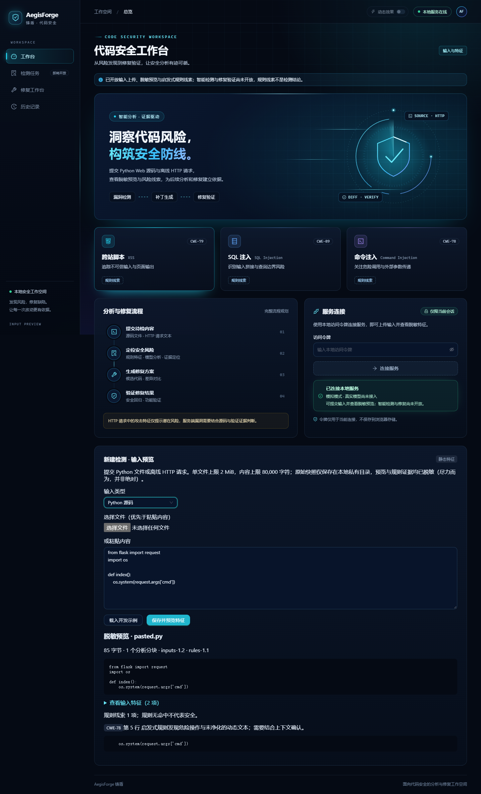

# 铸盾 AegisForge

基于大语言模型的 Web 代码漏洞智能检测与修复系统。

An LLM-powered platform for web code vulnerability detection, remediation, and fix validation.

项目面向网络空间安全技术课程设计，计划覆盖 XSS、SQL 注入和命令注入/执行风险，提供从代码/HTTP 输入、特征提取、智能分析到候选补丁和修复验证的 Web 工作流程。

## 当前状态

**M2 输入与特征提取已实现并通过本地验证。** 当前可连接服务、上传/粘贴 Python 源码或离线 HTTP 请求、载入示例、查看脱敏预览及三类启发式规则线索。规则线索不等于已确认漏洞；真实 LLM、检测任务、修复和动态验证尚未开放，M3 按用户要求暂缓。

M1 的深色科技风、流动盾牌与能量轨道、动效开关和减少动画设置继续保留。2026-11-05 完成 M2 的三轮 Claude/Codex 协作：[M2 设计](docs/m2-design.md)、[验证记录](docs/m2-verification.md)与 [协作记录](docs/collaboration-2026-11-05.md)。本地 143 后端通过、1 平台跳过，14 前端与 2 浏览器场景通过；120 源码/60 HTTP 样例已冻结，人工标注复核仍 pending。

- [实施与验收计划](PLAN.md)：系统框架、必做加分项、阶段交付、测试数据及验收门槛。
- [课程要求与评分映射](docs/requirements.md)：原始要求的项目化追踪。
- [协作规范](CONTRIBUTING.md)：Git、GitHub Issues、PR 与检查流程。
- [GitHub 计划总跟踪 #1](https://github.com/visibychen/AegisForge/issues/1)：M1–M7 的任务、依赖与验收进度。
- [GitHub 仓库](https://github.com/visibychen/AegisForge)。
- [系统设计初稿](docs/design.md)、[M1 验证记录](docs/m1-verification.md)与 [Anaconda 环境约定](AGENT.md)。

## 核心交付范围

- 上传 Python Web 源码或原始 HTTP 请求文本，提取特征并调用 LLM。
- 展示漏洞类型、风险等级、定位证据和修复建议。
- **加分项必做**：生成候选修复、展示代码差异、执行静态复检和受控样例动态验证。
- 保存历史、导出脱敏报告，交付可复现环境、完整代码和课程报告。

首版完整支持范围为 Python/Flask 风格源码。HTTP 请求包仅用于离线攻击特征与风险分析，不能单凭请求确认服务端漏洞或生成未知源码补丁。任意上传源码不在主机执行，动态验证仅适用于登记的隔离样例。

## 计划技术栈

React / TypeScript / Vite；Python 3.13 / FastAPI / Pydantic；SQLite / SQLAlchemy；独立 worker；可替换 LLM provider；pytest / Playwright；Docker 受控验证。

## 环境与安装

Python 必须使用 **Anaconda/conda 的 `AegisForge` 环境**，基线 Python 3.13；Node.js 使用 24.x。本机环境已创建。请在支持 `conda` 的终端（例如 Anaconda Prompt）进入仓库根目录后操作。

新机器首次创建环境：

```text
conda env create --file environment.yml
```

已有环境在声明变化时更新并重新激活，勿重复创建或删除其他环境：

```text
conda env update -n AegisForge --file environment.yml
conda activate AegisForge
```

安装开发/测试库、前端依赖并初始化：

```text
conda run -n AegisForge python -m pip install -r backend/requirements-dev.lock
npm --prefix frontend ci
conda run -n AegisForge python scripts/dev.py init
conda run -n AegisForge python scripts/dev.py migrate
```

`init` 生成被 Git 忽略的 `.env` 和随机访问令牌，不覆盖已有文件。环境设置 `PYTHONNOUSERSITE=1` 隔离用户级包，`PYTHONUTF8=1` 保持中文编码一致；所有 Python 安装、迁移和检查均在该环境执行，不向 base/系统 Python 安装库。

## 本地启动

在第一个终端运行后端：

```text
conda run --no-capture-output -n AegisForge python scripts/dev.py api
```

在第二个终端运行前端：

```text
npm --prefix frontend run dev
```

打开 [Web 工作台](http://127.0.0.1:5173/)。从本地 `.env` 查看 `AEGISFORGE_API_TOKEN`，在工作台输入以连接服务；令牌仅保留在当前页面会话内存，不保存到浏览器持久存储。连接后，在“新建检测 · 输入预览”选择类型、上传文件或粘贴内容，点击“保存并预览特征”。后端 [健康检查](http://127.0.0.1:8000/health)为公开存活接口，[API 文档](http://127.0.0.1:8000/docs)描述当前开放接口。M2 无需真实模型密钥或 Docker。

接受 UTF-8/UTF-8 BOM：源码 `.py`，HTTP `.http/.req/.txt`；单文件最多 2 MiB、内容最多 80,000 字符。原始快照仅存在被 Git 忽略的私有目录，预览使用尽力而为的凭据脱敏。HTTP 不重放，源码不执行。组合任务及模型预算将在 M3 开放任务时执行。



## 检查与测试

运行现阶段已实现的完整检查（依赖一致性、Ruff、后端测试、前端类型/交互测试和构建）：

```text
conda run --no-capture-output -n AegisForge python scripts/check.py
```

仅检查后端：

```text
conda run --no-capture-output -n AegisForge python scripts/check.py --backend-only
```

浏览器冒烟测试需先按上述方式启动服务并生成 `.env`。已安装 Google Chrome 时，可在 PowerShell 使用：

```powershell
$env:PLAYWRIGHT_CHANNEL = 'chrome'
npm --prefix frontend run test:e2e
```

当前浏览器场景覆盖服务连接/动效与 M2 上传/脱敏/三类规则线索/HTTP 边界/手机布局，不等同于最终真实模型和修复 E2E。其他平台可安装 Playwright Chromium 并使用默认 channel。

`scripts/check.py` 也校验 [冻结清单](samples/freeze.json)。开发代码仅使用 `samples/dev/`；保留集只作完整性、语法和解析预算检查，正式检测评测留待 M6。18 个受控修复例已预登记，实际隔离测试留待 M4。不要为适配规则结果改写保留标签或静默重新冻结。

## 依赖与后续推进

`environment.yml` 管理 conda 运行时，`backend/pyproject.toml` 声明 Python 库范围，`backend/requirements*.lock` 记录精确版本，前端由 `package-lock.json` 锁定。Python 锁文件由同一 conda 环境中的 pip-tools 生成；依赖调整同步声明、锁文件、测试及 PLAN。

**[M2 输入与特征提取 #3](https://github.com/visibychen/AegisForge/issues/3)** 已实现，PR 集成与人工标注复核状态见 Issue；**[M3 智能检测 #4](https://github.com/visibychen/AegisForge/issues/4) 暂缓，未开始实现**。后续仍通过阶段 Issue、功能分支和 PR 留存证据；修复与验证加分项保留在 M4，真实模型和最终评测保留在 M3/M6。
