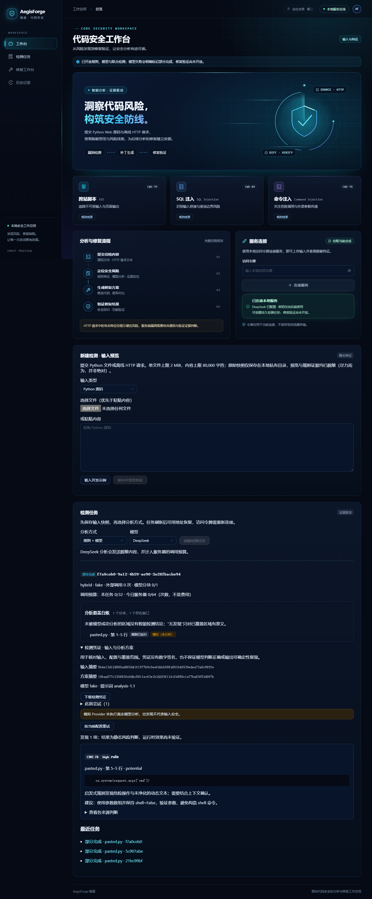
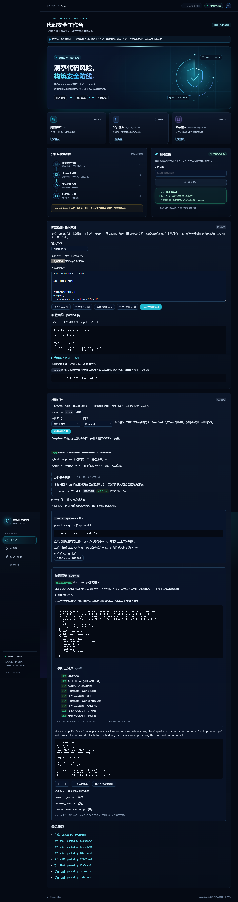

# 铸盾 AegisForge

基于大语言模型的 Web 代码漏洞智能检测与修复系统。

An LLM-powered platform for web code vulnerability detection, remediation, and fix validation.

项目面向网络空间安全技术课程设计，计划覆盖 XSS、SQL 注入和命令注入/执行风险，提供从代码/HTTP 输入、特征提取、智能分析到候选补丁和修复验证的 Web 工作流程。

## 当前状态

**2026-11-12更新：M6质量修复与定向验证已推进，见[本轮证据](docs/m6-quality-2026-11-12.md)。** 新增可达定义、同流合并、可见静态复核和版本化运行审计，修正容器修改导致的漏报及修复业务约束。真实定向首批11/12成功，漏报修正后另作1/1复验，不合并回填；累计992/1000调用。Claude账户遇到验证问题，按用户最新要求改由Codex独立完成，原会话保留。正式三轮验收及人工标签复核仍未完成，以下11月11日数字为保留的历史基线。

**M6 全量实验及 Sonnet5.5/high 三轮协作优化已完成，[PR #16](https://github.com/visibychen/AegisForge/pull/16) 待审。正式验收仍未通过：** 联合源码三轮均值Precision约59.2%、Recall约98.1%，HTTP F1=1；首次修复36/54、SQLi8/18，未达到PLAN门槛，人工标签复核仍pending。改进后开发A/B和后续候选诊断单独保存，不能替代原结果。见[测试报告](docs/test-report.md)、[优化设计](docs/m6-design.md)、[三轮协作](docs/collaboration-2026-11-11.md)。本轮真实模型累计942/1000次，已停止付费调优。M7报告/查重/发布仍待完成。

**M5 完整工作台已完成实现和开发验收，[PR #15](https://github.com/visibychen/AegisForge/pull/15) 待审、未合并。** 总览/历史筛选分页、逻辑移出、服务端风险筛选、证据行号导航、原文候选对比、修复历史、JSON/Markdown报告已实现。创新包括修复说明卡、500行源码窗口和报告完整性校验；原有M4候选补丁与受控验证保留。干净 Compose 完整浏览器验收通过。见[M5设计](docs/m5-design.md)、[验证](docs/m5-verification.md)、[协作](docs/collaboration-2026-11-10.md)。

M1 科技流动视觉继续保留。M3 按用户分工完成三阶段、同一 Claude 会话四次真实调用，并在审查中提出和落实创新：逐块覆盖账本、可下载检测凭证。验证包含三类真实 DeepSeek 开发演示；详见 [M3 验证](docs/m3-verification.md)、[设计](docs/m3-design.md)和 [协作记录](docs/collaboration-2026-11-07.md)。冻结的120源码/60 HTTP样例仍保持原划分；M6真实评测已完成、人工标注复核仍pending。

- [实施与验收计划](PLAN.md)：系统框架、必做加分项、阶段交付、测试数据及验收门槛。
- [课程要求与评分映射](docs/requirements.md)：原始要求的项目化追踪。
- [协作规范](CONTRIBUTING.md)：Git、GitHub Issues、PR 与检查流程。
- [GitHub 计划总跟踪 #1](https://github.com/visibychen/AegisForge/issues/1)：M1–M7 的任务、依赖与验收进度。
- [GitHub 仓库](https://github.com/visibychen/AegisForge)。
- [系统设计初稿](docs/design.md)、[M1 验证记录](docs/m1-verification.md)与 [Anaconda 环境约定](AGENT.md)。

## 核心交付范围

- 上传 Python Web 源码或原始 HTTP 请求文本，提取特征并调用 LLM。
- 展示漏洞类型、风险等级、定位证据和修复建议。
- **加分项必做**：生成候选修复、展示代码差异、执行静态复检和受控样例动态验证。
- 保存历史、导出脱敏报告，交付可复现环境、完整代码和课程报告。

首版完整支持范围为 Python/Flask 风格源码。HTTP 请求包仅用于离线攻击特征与风险分析，不能单凭请求确认服务端漏洞或生成未知源码补丁。任意上传源码不在主机执行，动态验证仅适用于登记的隔离样例。

## 计划技术栈

React / TypeScript / Vite；Python 3.13 / FastAPI / Pydantic；SQLite / SQLAlchemy；独立 worker；可替换 LLM provider；pytest / Playwright；Docker 受控验证。

## 环境与安装

Python 必须使用 **Anaconda/conda 的 `AegisForge` 环境**，基线 Python 3.13；Node.js 使用 24.x。本机环境已创建。请在支持 `conda` 的终端（例如 Anaconda Prompt）进入仓库根目录后操作。

新机器首次创建环境：

```text
conda env create --file environment.yml
```

已有环境在声明变化时更新并重新激活，勿重复创建或删除其他环境：

```text
conda env update -n AegisForge --file environment.yml
conda activate AegisForge
```

安装开发/测试库、前端依赖并初始化：

```text
conda run -n AegisForge python -m pip install -r backend/requirements-dev.lock
npm --prefix frontend ci
conda run -n AegisForge python scripts/dev.py init
conda run -n AegisForge python scripts/dev.py migrate
```

`init` 生成被 Git 忽略的 `.env` 和随机访问令牌，不覆盖已有文件。环境设置 `PYTHONNOUSERSITE=1` 隔离用户级包，`PYTHONUTF8=1` 保持中文编码一致；所有 Python 安装、迁移和检查均在该环境执行，不向 base/系统 Python 安装库。

## 本地启动

在第一个终端运行后端：

```text
conda run --no-capture-output -n AegisForge python scripts/dev.py api
```

在第二个终端运行独立 worker：

```text
conda run --no-capture-output -n AegisForge python scripts/dev.py worker
```

在第三个终端运行前端：

```text
npm --prefix frontend run dev
```

打开 [Web 工作台](http://127.0.0.1:5173/)。从本地 `.env` 查看 `AEGISFORGE_API_TOKEN`，在工作台输入以连接服务；令牌仅保留在页面内存。保存输入后，在“检测任务”选择策略和模型、创建任务。API 只入队，须运行 worker；fake 会明确标为部分完成，规则模式不会调用模型。任务链接可刷新恢复，重新连接后查看发现、覆盖、凭证及旧尝试摘要。后端 [健康检查](http://127.0.0.1:8000/health)公开存活，[API 文档](http://127.0.0.1:8000/docs)描述接口。

接受 UTF-8/UTF-8 BOM：源码 `.py`，HTTP `.http/.req/.txt`；单文件最多 2 MiB，任务最多 10 文件/10 MiB、80,000 字符/8 块。原始快照仅存在被 Git 忽略的私有目录，预览使用尽力而为的脱敏。当前完整服务密钥出现在输入时拒绝保存/分析。HTTP 不重放，源码不执行。



## DeepSeek 配置

密钥 **只设为 OS 环境变量 `AEGISFORGE_DEEPSEEK_API_KEY`**，不要写进 `.env`、源码、命令参数或页面。另设非秘密的 `AEGISFORGE_MODEL_MODE=real`，可选 `AEGISFORGE_DEEPSEEK_MODEL=deepseek-flash`（默认）或 `deepseek-v4-pro`。密钥格式须为 16–256 位字母、数字、点、下划线或连字符。未配置/格式不合规时只公开 fake 别名。

本机已安全配置 Windows 用户环境变量。`scripts/dev.py api/worker` 只为对应子进程导入它们，兼容先前已打开的终端；其他平台或直接运行 `python -m app.worker` 时需确保进程继承同一环境。Claude 启动不导入该密钥。用户环境变量并非阻止同用户其他进程读取的隔离机制。

默认单次模型超时 60 秒、每次任务尝试总时限 180 秒（跨租约恢复保持起点）；任务累计最多 32 次、每数据库部署每 UTC 日最多 64 次外部调用。`AEGISFORGE_MAX_MODEL_CALLS`、`AEGISFORGE_DAILY_MODEL_CALLS` 可调；这些是次数上限，不是金额上限。手动重试最多两次且不清零累计调用，按当前配置重跑全部块并归档原结果/凭证。排队后模型/提示词等方案变化时拒绝执行，提示重试。

已验证的有界真实开发演示（默认三例；会调用付费服务）：

```text
conda run --no-capture-output -n AegisForge python scripts/deepseek_smoke.py
```

它仅加载开发样例，临时数据库与安全摘要写入被忽略的 `data/`；不保存原始模型正文，不执行源码，不访问保留集标签。它采用进程内 worker 验证真实适配链；独立 CLI 与浏览器另有离线验证。

## 检查与测试

运行现阶段已实现的完整检查（依赖一致性、Ruff、后端测试、前端类型/交互测试和构建）：

```text
conda run --no-capture-output -n AegisForge python scripts/check.py
```

仅检查后端：

```text
conda run --no-capture-output -n AegisForge python scripts/check.py --backend-only
```

浏览器冒烟测试需先按上述方式启动服务并生成 `.env`。已安装 Google Chrome 时，可在 PowerShell 使用：

```powershell
$env:PLAYWRIGHT_CHANNEL = 'chrome'
npm --prefix frontend run test:e2e
```

当前默认四个浏览器场景覆盖连接/动效、上传/脱敏/规则/HTTP 边界、任务/独立 worker/模拟模式/重试/刷新/凭证下载及手机布局。浏览器测试固定选 fake，不消费真实模型预算；另外可显式开启真实修复 E2E，下面给出命令。其他平台可安装 Playwright Chromium。

`scripts/check.py` 也校验[冻结清单](samples/freeze.json)。保留集已在M6完整实验中暴露，后续调优结果不再是独立评测。18个受控修复例三轮首次候选共54次已完成；原标签、源码及失败不回改，原始结果由Git历史守卫和重算审计保护。M4开发闭环与M6正式基线、事后诊断分开记录。

## 依赖与后续推进

`environment.yml` 管理 conda 运行时，`backend/pyproject.toml` 声明 Python 库范围，`backend/requirements*.lock` 记录精确版本，前端由 `package-lock.json` 锁定。Python 锁文件由同一 conda 环境中的 pip-tools 生成；依赖调整同步声明、锁文件、测试及 PLAN。

**[M2 #3](https://github.com/visibychen/AegisForge/issues/3)** 与 **[M3 #4](https://github.com/visibychen/AegisForge/issues/4)** 的实现与本地验收已完成，PR集成状态以Issue为准。M3分支堆叠在M2 PR #12上，避免重复审查前序改动。M4修复/验证加分项、M5完整历史/报告已实现；M6真实模型对比及18例三轮首次修复实验已完成，数值未全达标，见测试报告。


## M4 修复与受控部署

安装并启动 Docker Desktop 的 Linux engine 后，在 Anaconda AegisForge 环境运行：

```text
conda run --no-capture-output -n AegisForge python scripts/build_validator.py
conda run --no-capture-output -n AegisForge python scripts/deploy.py build
conda run --no-capture-output -n AegisForge python scripts/deploy.py up
npm --prefix frontend run dev
```

先用 `scripts/dev.py init` 建立本地 API token；真实模型仍只从 OS 环境变量读取。不要与本地主机 api/worker 同时连接同一个运行数据库；启动 Compose 前停止这些进程。Compose 的 migrate、api、worker、validator 都在 Linux 访问共享 data，API 绑定 127.0.0.1:8000；Linux 新机器需使绑定目录 data 可由 UID 1000 写入。首次镜像构建要下载 Chromium 及系统依赖，可能耗时较久。浏览器只使用本地 API token，永远不接触模型 key。

连接页面后可选择“受控 XSS/SQLI/CMDI 示例”，保存、检测，在发现处按当前模型生成候选修复。模型修复会消费额外调用；HTTP 缺源码不可修复，含脱敏占位符或多块源码拒绝自动补丁。候选不覆盖输入。查看门禁、影响和契约，下载补丁/源码，申请动态验证。独立控制器离线时页面保留 pending 并提示启动 runner；环境失败明确为 error；普通源码不在登记表内为 unverified。通过只表示本次固定测试集通过。

离线对照/对抗验收、部署边界检查及有界真实演示：

```text
conda run --no-capture-output -n AegisForge python scripts/repair_smoke.py controls
conda run --no-capture-output -n AegisForge python scripts/probe_deployment.py
conda run --no-capture-output -n AegisForge python scripts/repair_smoke.py live
```

live 最多12次外部调用/数据库部署，实际本次三例用了9次；临时输入和DB留在被忽略的data。它使用进程内API/worker，并且候选只在Docker执行。独立部署真实浏览器链另行验证，需显式选择：

```powershell
$env:PLAYWRIGHT_CHANNEL = 'chrome'
$env:AEGISFORGE_E2E_REAL = '1'
npm --prefix frontend run test:e2e -- --workers=1 tests/e2e/repairs.spec.ts --grep 'real DeepSeek'
```

默认 E2E 跳过这个付费场景；四个离线场景不调用真实模型，修复动态场景需要上述Compose及验证镜像。`python scripts/deploy.py down` 停止本项目容器并保留 data。仅本机开发也可 `python scripts/dev.py validator` 启动独立受信 runner；它不导入模型 key，但同 Windows 用户不构成 OS 权限隔离，不能替代 Compose 的隔离验收。




## M5 工作台和报告

连接服务后，总览按当前检测尝试统计静态风险，真实/模拟/仅规则状态分开；历史可按编号、状态、CWE、等级筛选分页。发现列表支持服务端筛选和证据导航，源码按绝对行号高亮、支持键盘N/P和End，超过500行自动切换窗口；HTTP定位到对应字段。修复页可选择历史候选、并排对比改动与规则/模型位置、查看门禁和说明卡。父任务重试后的候选标为旧尝试，可查看/下载，不能重新申请动态验证。

“移出历史”需要确认，关闭任务、发现、报告和修复入口；调用预算和共享输入保留，输入仍可按artifact ID预览，不是彻底擦除。活动检测/修复/动态验证需先取消。物理回收另行设计。新增0006迁移；本机模式先`python scripts/dev.py migrate`，Compose模式重新build后up自动迁移。存在已移出记录时拒绝降级0006。

历史行可下载JSON或可读Markdown报告，包含覆盖、当前/旧尝试、发现关联和修复说明卡；默认排除源码、文件名、HTTP参数名和模型自由文本。JSON内容摘要可离线检查：

```text
conda run --no-capture-output -n AegisForge python scripts/verify_report.py report.json
```

校验器仅解析不超过4MiB的常规UTF-8 JSON文件，失败返回非零，不执行任何内容。摘要不是签名，不保证模型判断正确；Markdown展示的是JSON摘要，不覆盖Markdown自身的文字。

若Windows禁止默认8000端口，可在启动Vite的终端设非秘密环境变量`AEGISFORGE_DEV_API_PORT=28000`，同时将API用`python -m uvicorn app.main:app --app-dir backend --host 127.0.0.1 --port 28000`启动。只允许回环代理，默认配置保持8000。

GitHub `Workbench Compose E2E` 从干净Ubuntu运行迁移、独立服务、隔离探测和完整默认浏览器流程，不传模型key，显式真实模型场景跳过；白名单报告和截图保留为CI artifact。M6新增按浏览器分目录、实际通过/跳过/失败/波动计数，避免Firefox执行清理Chromium证据；实际运行状态见测试报告。M7课程模板报告/查重/最终发布仍待完成。

CI浏览器采用版本匹配、摘要固定的官方Playwright镜像和只读挂载的主机Node24，避免Ubuntu软件源DNS故障阻塞依赖安装。仅受信界面测试使用回环服务的host网络，无模型key/Docker socket；执行候选的无网络隔离容器保持原限制。实际Chromium5通过/1显式skip、Firefox1通过及两浏览器截图保留已验证，来源与固定镜像摘要见测试报告。

## M6 实验与审计

以下Python命令均在`conda activate AegisForge`后运行；审计不调用模型或执行候选：

```powershell
python scripts/m6_freeze_guard.py     # 与预调优提交比较samples及原始baseline
python scripts/m6_verify.py           # 从原始行重算、核对JSON/CSV/哈希；记录一致返回0
python scripts/acceptance.py          # 核心数值门槛：本次实际返回1（未达标）
python scripts/analyze_detection.py --output data/m6-attribution.json
```

`acceptance.py`返回0仅表示列出的核心实验门槛满足，1为记录有效但未达标，2为记录无效；性能/覆盖/资源/浏览器等不在其重算范围内。普通CI核验真实54次容器重放与记录一致，严格数值作业只在`workflow_dispatch`执行（工作流进入默认分支后方可从GitHub界面触发），不将记录完整误称课程达标。

完整付费基线命令与恢复约定见[协议](docs/m6-protocol.md)，本轮已经执行，**不要新建账本重跑以绕过1000次上限**。开发A/B、定向回归及后续修复各有固定配置/检查点，结果分文件不可覆盖；它们不具有独立保留集含义。动态候选仅由无模型凭据的固定Docker runner执行，本机Docker引擎不可用时使用GitHub Ubuntu证据。
