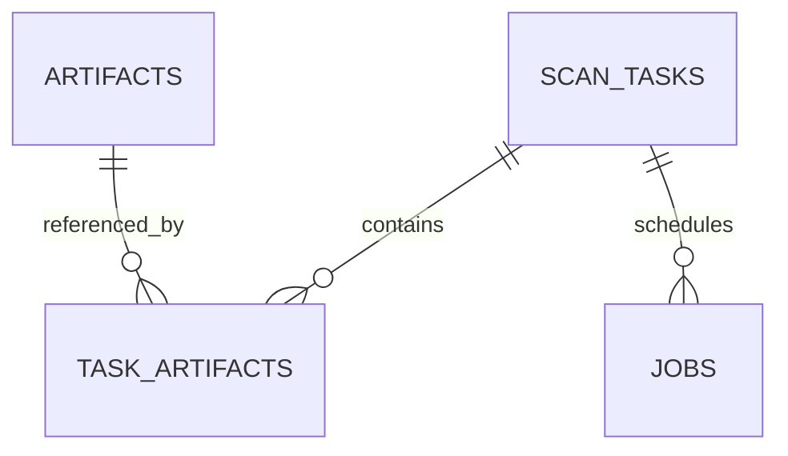

# AegisForge 系统详细设计初稿

版本：M1 基础设计归档；M2 的现行扩展见 [输入/特征设计](m2-design.md)与 [M2 验证](m2-verification.md)。关联：PLAN 1.3 / R01、R02、R03、R08 / Issue #2、#3。以下保留 M1 阶段的实现基线；当前 capabilities 阶段为 M2，上传与预览已开放，任务与真实模型仍未开放。

本稿描述当前工程基础与后续模块边界。M1 已定义基础协议、数据库迁移、配置、健康检查、鉴权和前端壳；上传/特征提取在 M2、真实模型及持久任务执行在 M3、修复验证在 M4 实现。未实现的接口不返回模拟成功。

## 运行环境与启动结构

Python 由 Anaconda 的 `AegisForge` 环境管理，版本基线 3.13；本机创建版本 3.13.18。`environment.yml` 负责运行时，`backend/requirements.lock` 与 `requirements-dev.lock` 锁定运行/开发库，`pyproject.toml` 声明库范围。前端使用 Node.js 24 和 npm 锁文件。参见 [ADR 0001](decisions/0001-anaconda.md)。

`scripts/dev.py` 提供本地初始化、迁移、API 与前端启动命令；Python 脚本检查解释器确实属于指定 conda 环境。`.env` 保存在根目录并由后端读取，不进入 Git；初始化不会覆盖已存在配置。服务默认只监听 `127.0.0.1`。

## 当前模块及职责

| 模块 | M1 责任 | 后续边界 |
| --- | --- | --- |
| core/config | 带前缀的环境配置、SecretStr、大小上限及模型模式 | 后续添加已登记 provider，不接收用户任意 endpoint |
| core/database | SQLite 连接、外键、WAL、锁等待 | 单 worker 作业领取与租约由 M3 实现 |
| models + migrations | artifacts、scan_tasks、task_artifacts、jobs 的结构及可回滚迁移 | Finding/Repair/Validation/ModelCall 随 M3/M4 新迁移加入 |
| schemas/contracts | 任务请求、漏洞输出、修复哈希、验证状态与错误协议 | M3 增加真实原文/证据位置检查，不只依赖类型校验 |
| llm/provider | 异步 Provider 协议和明确不作安全判断的 FakeProvider | 真实适配、重试、预算和提示词在 M3 实现 |
| app/main | 健康、能力查询、令牌鉴权、CORS、请求追踪及错误处理 | 检测/修复业务路由随各阶段开放 |
| frontend | 工作台、离线边界、健康状态、显式服务连接 | 后续逐步开放输入、结果、修复和历史页面 |

## API 协议

| 接口 | 鉴权 | 正常响应 | 失败行为 |
| --- | --- | --- | --- |
| `GET /health` | 公开 | `status=ok`、`request_id` | 只作存活检查，不证明模型/数据库已就绪 |
| `GET /api/v1/capabilities` | Bearer 访问令牌 | 版本、当前阶段、模式、可用能力、计划类型及大小限额 | 无令牌/错误令牌 401；未配置令牌 503 |
| `GET /docs`、`GET /openapi.json` | 本地开发公开 | 当前已开放 HTTP 接口文档 | 不包含凭据或数据目录 |

M1 的 `analysis_available`、`repair_available`、`dynamic_validation_available` 均为 false，`supported_input_types` 为空；`planned_input_types` 是规划说明。未开放的 `/api/v1/scans` 等接口返回 404，不假造任务。

请求 ID 由服务器生成 UUID，返回在 JSON 与 `X-Request-ID` 头中，不信任调用者自带追踪头。错误统一为：

```json
{
  "request_id": "server-generated-uuid",
  "error": {"code": "UNAUTHORIZED", "message": "访问令牌无效或缺失。"}
}
```

鉴权比较不把令牌写入响应。参数错误不回显原始内容；未处理异常返回通用错误，避免泄漏凭据与本地路径。CORS 仅允许配置的本地前端来源；业务接口仍依赖令牌，不能把 CORS 当作鉴权。

## 输入输出协议约束

- `ScanCreate` 要求 1–10 个唯一 Artifact UUID，策略为 rules/llm/hybrid；当前模型别名仅定义 fake。
- `Finding` 绑定三类 category/CWE，限制风险枚举、置信度范围和字符串长度，未知字段拒绝。源码行号从 1 开始且区间有序；HTTP 使用字段路径而非虚构源码行号。
- 模型输出只能声明 potential/attack_indicator，不能自称 verified；后续验证证据由服务端独立生成。HTTP 载荷不等于服务端漏洞。
- `AnalysisResult` 标记 schema 1.0、真实/模拟模式、完成性、发现和警告；fake 不得声称完成真实分析。
- `RepairCreate` 必须携带 64 位小写十六进制源快照哈希。验证状态区分 passed/failed/unverified/error，后续遵守 PLAN 的动态判据。

## 数据库概念结构与逻辑设计



| 表 | 关键字段 | 约束及删除规则 |
| --- | --- | --- |
| artifacts | id、input_type、language、display_name、storage_key、sha256、size_bytes、created_at | 输入类型检查；大小为正；存储键唯一；引用存在时禁止删除 |
| scan_tasks | id、status、strategy、model_alias、rule_version、prompt_version、error_code、时间 | 状态/策略 CHECK；状态索引；删除任务级联删除关联与作业 |
| task_artifacts | scan_id、artifact_id | 联合主键防重复，两个外键保证引用完整性 |
| jobs | id、scan_id、kind、status、attempts、idempotency_key、lease_until、heartbeat_at、错误、时间 | 幂等键唯一；状态/非负尝试次数 CHECK；首版仅 scan 类型 |

UUID 为文本主键。所有 ORM 时间写入前转 UTC、读取后恢复 UTC 时区。文件内容不进入数据库，未来存储位置以内部键引用。ORM 与 Alembic 初始迁移分离，测试比较两者 schema，验证升级、重复升级、回滚、重建、持久化与外键级联。

M1 只定义作业元数据，不运行 worker，也不承诺排队恢复已实现。首次运行先显式迁移；后端启动不会偷偷用 `create_all` 替代版本迁移。

## 前端状态与数据流

工作台启动通过同源 Vite 代理请求 `/health`，状态为检查中/在线/未连接。用户输入本地令牌并主动连接后查询 capabilities；成功时清空令牌，失败显示错误。令牌不写入 localStorage/sessionStorage，不通过 VITE 环境变量打包。

工作台用明确的基础预览说明和计划支持标记展示范围，没有虚构漏洞数量、检测结果或通过率。未实现菜单不可操作。服务未连接时页面本身仍可查看。前端类型检查、交互测试和构建作为 CI 的独立检查。

## M1 验证与后续设计

基础检查由 `scripts/check.py` 编排：pip 依赖一致性、Ruff、后端协议/鉴权/迁移测试、前端类型/交互测试及生产构建。CI 在 Windows/Linux 的同名 conda 环境检查后端，在 Linux 检查前端；真实模型调用和动态执行不属于 M1 验收。

后续在原模块边界内添加文件校验/脱敏、持久任务执行、真实模型、候选补丁及固定样例 runner。每阶段补充详细流程、schema 和迁移，不修改已发布迁移去掩盖数据结构变化。

参考：[FastAPI 测试](https://fastapi.tiangolo.com/tutorial/testing/)、[Alembic 迁移](https://alembic.sqlalchemy.org/en/latest/tutorial.html)、[Conda CI action](https://github.com/conda-incubator/setup-miniconda)。
