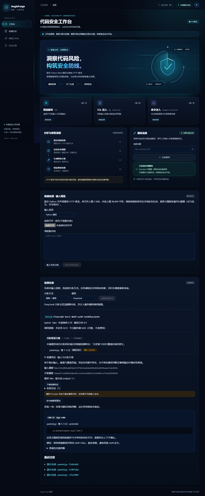

# M3 智能检测验证记录

日期：2026-11-07。分支 `feat/4-deepseek-detection`，Refs #4，依赖仍待审的 M2 PR #12。实现及本地验收完成，PR 集成和远端 CI 状态以 GitHub 为准。Python 全部使用 Anaconda `AegisForge` / 3.13.18。

## 实际检查

| 检查 | 结果 |
| --- | --- |
| `conda run --no-capture-output -n AegisForge python scripts/check.py` | 后端213通过、1 Windows symlink跳过；前端19通过；pip/Ruff/format/类型/构建/冻结完整性通过 |
| Alembic/metadata | 全量测试内执行，0001→0004、重复升级、回滚base再升级及模型一致性通过 |
| `$env:PLAYWRIGHT_CHANNEL='chrome'; npm --prefix frontend run test:e2e` | 3 Chrome 场景通过：连接/动效、输入边界、任务闭环；1440px与390px布局检查通过 |
| `conda run --no-capture-output -n AegisForge python scripts/deepseek_smoke.py` | 下列三类真实开发例完成；最多每任务4次，每例1块，实际各1次外部调用 |
| 独立 worker | 后端测试启动独立 `python -m app.worker --once`，从持久队列消费并重连DB读取；浏览器同时连接独立API、worker和Vite |
| OS key 防护 | 不从dotenv读取；非法格式不发送；完整key在content/fields/hints/system时0预留/0发送；上传明文/BOM/CRLF/编码HTTP/文件名拒绝，存量读取也拒绝；只含前缀不拒绝 |

后端覆盖网络超时/429/5xx/401/402、响应字节/JSON/截断、模式/来源/verified伪造、紧证据与歧义/长区间/HTTP字段、独立sink合并、严重性分歧、SQL锁/心跳故障/未知异常保留、并发领取/旧租约fencing/恢复上限、累计/日预算、取消/重试归档、方案漂移、跨恢复deadline和在途取消。CI不调用付费模型。

前端覆盖幂等键复用、401停止轮询、覆盖缺口与rules-only语义。浏览器任务场景固定选fake，验证外部调用0、规则发现、覆盖/凭证下载、旧尝试、刷新后重新鉴权与当前终态；只读取当前状态标签，避免误把旧摘要当终态。凭证导出断言不含API令牌、源码或display_name，所有内容作为文本渲染。

## 真实 DeepSeek 开发演示

已登记请求模型 `deepseek-flash`；`analysis-1.1` / `rules-1.1`，JSON output，thinking disabled，温度0，输出上限2048 token。2026-11-07 实际执行；[机器可读脱敏证据](verification/deepseek-2026-11-07.json)记录样例哈希、token、调用状态、版本、receipt和去文件名coverage，不含请求头、密钥、源码或原始模型正文。

| 开发样例 | LLM发现 | 任务 | 调用数 | 输入/输出token | 服务时间 |
| --- | --- | --- | --- | --- | --- |
| SRC-XSS-01-V | CWE-79 | completed | 1 | 1364 / 207 | 4461ms |
| SRC-SQLI-01-V | CWE-89 | completed | 1 | 1404 / 188 | 2957ms |
| SRC-CMDI-01-V | CWE-78 | completed | 1 | 1383 / 190 | 2436ms |

三例均 `analysis_complete=true`、模型覆盖 succeeded 且包含期望CWE，不以仅规则发现充当LLM通过。演示采用 TestClient + 进程内 run_once 验证真实适配链；独立进程生命周期由上面的CLI/浏览器场景另证。前三次初稿响应因来源协议拒绝发布partial；wire分离后才通过，没有抹去失败历史。

## 界面与局限

[手机布局截图](screenshots/m3-scan-mobile.png)。截图为明确标注的fake任务，没有把模拟结果冒充真实演示。

构建成功，Vite仍提示约617kB主bundle超过500kB；留M5按需加载优化，没有上调阈值隐藏。Starlette TestClient有httpx迁移弃用警告，不影响本次运行。Windows主机不能创建symlink而跳过1项；Linux CI需实际执行该项。

这三例只证明功能链路，不是保留集准确率/安全率或统计性能评测；没有读取保留标签调提示词。M2人工标注复核、M4候选补丁/动态验证、M5完整历史/报告、M6正式对比和性能实验仍未完成。凭证无签名，不保证结果正确/确定复现；限额是次数而非金额。单用户本地环境不抵御同用户恶意进程读取环境/私有文件。
