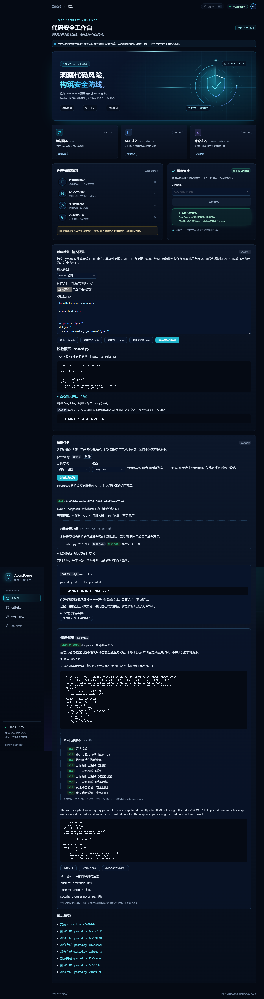

# M4 验证记录

日期：2026-11-08。分支 `feat/5-repair-validation`，基于 M3 `ca1f4ff`，Refs #5。实现和本地验收完成；PR/CI 集成状态见 Issue #5。M5 完整页面/报告和 M6 正式评测未提前完成。

## 环境与自动化

主机全部 Python 命令在 Anaconda AegisForge，Python 3.13.18；Node 24、Chrome、Docker Desktop Linux engine 29.4.3。模型为 deepseek-flash，OS 环境独占 key，不使用 dotenv 供给模型密钥。容器 Python 3.13 基础镜像按 digest 固定，验证容器 Flask 3.1.2 / Playwright 1.64.1 及依赖版本、PyPI SHA-256 锁定，Chromium 156.0.8078.4。

- `python scripts/check.py`：依赖、Ruff/format、冻结数据完整性、类型、前端测试与构建通过。最后补充冷启动回归后 `--backend-only` 为 **304 passed / 1 Windows symlink skipped**；前端 **25 passed**。完整后端覆盖迁移 0001–0005、已有 M2/M3 行为、编辑/语法/秘密/范围、预算/取消/租约/复检保留/父重试、风险匹配及动态协议。
- 七个第一轮红测试全部转绿。Codex 最后新增九项独立复核：不等长块风险复用、移动/克隆、邻近同类风险、契约绑定/候选去重、可信挂载路径、示例哈希、Windows 路径转换、失败契约保留、API 重启后的首次修复写操作。
- `PLAYWRIGHT_CHANNEL=chrome npm --prefix frontend run test:e2e -- --workers=1`：**4 passed / 1 显式付费场景 skipped**。连接/动效、输入/HTTP/脱敏、任务/重试/刷新/检测凭证、模拟候选下载/真实动态失败/刷新恢复/手机布局。默认不消耗模型调用。
- 显式 `AEGISFORGE_E2E_REAL=1` 后执行 repairs.spec.ts 的 `real DeepSeek`：**1 passed，约17秒**。使用独立 Compose API、worker、Docker 控制器；真实 XSS 修复九个门禁全过，展开执行契约，桌面/390px截图，无水平溢出。该链另用3次外部调用。

现存非阻断提示：Starlette 的 httpx 测试客户端弃用提示、Vite 约628kB主包警告。没有为消除提示更新无关依赖；包拆分留 M5。

## 真实模型闭环

运行 `python scripts/repair_smoke.py live`，只加载开发集的三个登记样例，临时数据库、原始输入和候选留在被忽略的 data。检测必须确有 LLM 来源命中目标 CWE，不能用规则代替。最多12次/临时数据库，本次实际 **9次**：三次检测、三次补丁生成、三次 LLM 复检。

| 开发例 | 目标 | 检测 | 静态/模型门禁 | Docker 安全/业务 | 最终结论 |
| --- | --- | --- | --- | --- | --- |
| SRC-XSS-01-V | CWE-79 | completed，真实 LLM | 全过 | 3/3 | passed |
| SRC-SQLI-01-V | CWE-89 | completed，真实 LLM | 全过 | 3/3 | passed |
| SRC-CMDI-01-V | CWE-78 | completed，真实 LLM | 全过 | 3/3 | passed |

[机器摘要](verification/m4-deepseek-2026-11-08.json)包含真实调用元数据、模型/版本/参数、源码/候选/diff/发现锚点摘要、门禁、固定测试和镜像绑定。scan 的全局预算统计包括其修复调用，不能再与 repair 调用重复相加；摘要的 detection_call_count 单独统计检测作业。模型自由文本、源码、API token、私有路径和 key 不进入公开摘要。脚本采用进程内 API/worker，候选执行始终在 Docker；独立部署由上面的真实浏览器另行验证。

最终 driver 的逐项异常隔离调整后，复用原三个真实候选重新执行固定测试，全过，**零额外模型调用**；[独立部署控制器也重新验证通过](verification/m4-deployment-2026-11-08.json)。开发演示加真实浏览器共12次请求。不是正式准确率/修复率评测，也不是最终“三轮模型实验”的替代。

## 对照、对抗与资源

`python scripts/repair_smoke.py controls`：**6个V/S对照 + 5个对抗探针验收通过**，见[摘要](verification/m4-controls-2026-11-08.json)。原 V 版的目标安全测试均失败，三个 S 版全部安全/业务断言通过。SQLi 原 V 的 O'Reilly 业务输入为500/失败，这是原问题的一部分，如实保留，不修改冻结样例或断言。

五个候选探针：伪造 stdout JSON/立即退出、试图 SIGSTOP driver、无限循环、写死业务 True、FIFO ping 日志，全部未被记为 passed。无限循环约28.4秒由看门狗/宿主完成回收；FIFO 未阻塞 driver。输出严格单行、nonce/候选哈希/测试名/布尔/退出码校验及异常清理还有后端单元覆盖。

`python scripts/probe_deployment.py` 的[实测](verification/m4-isolation-2026-11-08.json)：API/worker UID1000、NoNewPrivs、CapEff=0，无 CLI/socket，Docker host TCP 不可达；受信控制器独占 socket，无模型 key。候选 UID65532、仅 lo、外部网络连接失败、候选文件只读、无 socket、512MiB、1CPU、XSS128PID。此处是实际读取 cgroup/权限和连接探测，不冒称完成 M6 的所有资源耗尽压力测试。

首次64PID实测浏览器占57槽位，后续 guard 失败；128PID 下正常，故仅调整 XSS 容量。SQLi/CMDi 仍64。完整依据、同 UID/seccomp黑名单、Chromium --no-sandbox 和宿主可信域局限见[ADR0003](decisions/0003-m4-controlled-validation.md)。Docker只用于登记样例，不宣称可安全执行任意敌意 Python。

## 协作与交付边界

使用用户指定的 gpt-to-claude 工作流，原会话三阶段四次成功调用，Sonnet5.5/high，第二阶段 Claude 主开发，第三阶段讨论后 Codex 最终实现；详见[协作记录](collaboration-2026-11-08.md)。没有中断仍在工作的 Claude。创新包含门禁账本、变更影响镜头、执行契约和候选 guard。

密钥精确字节扫描覆盖待提交文本/二进制、全部 M4 commit patch、本地 .env 和四份 Claude 交接；通过后方可推送。运行 DB、候选源码、原始模型响应不提交。保留集只做冻结/结构/解析完整性检查，18个正式修复实验及人工标注复核仍待 M6。PR 堆叠在未合并的 M3 PR #13 之上，用户审阅前不自动合并。

[手机截图](screenshots/m4-real-repair-mobile.png)。
