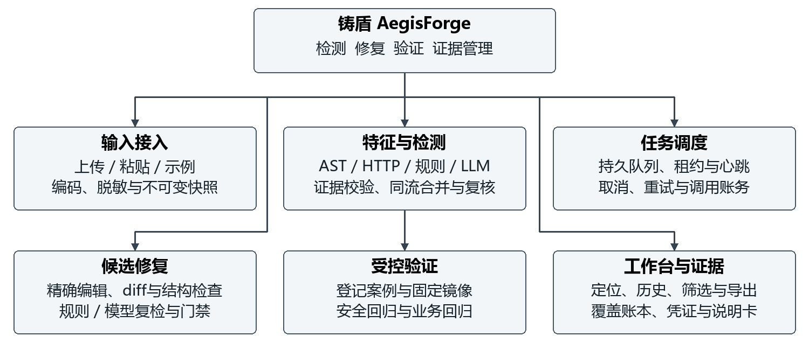
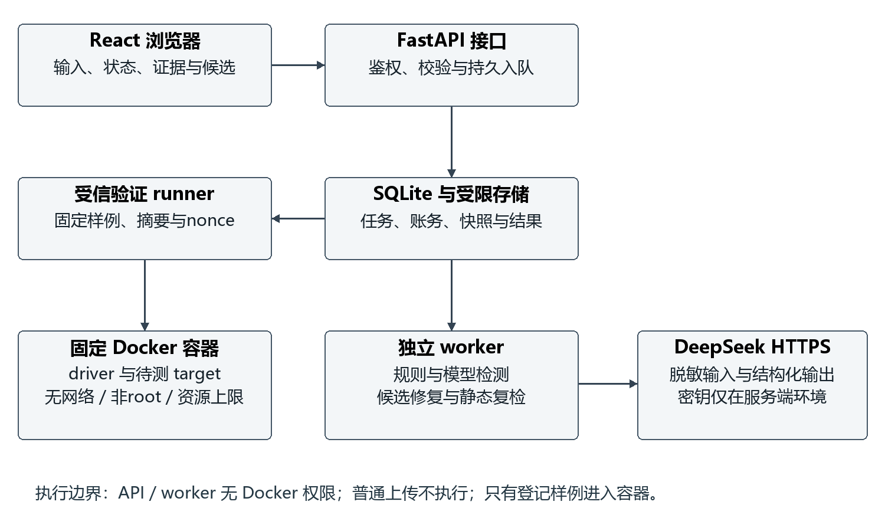
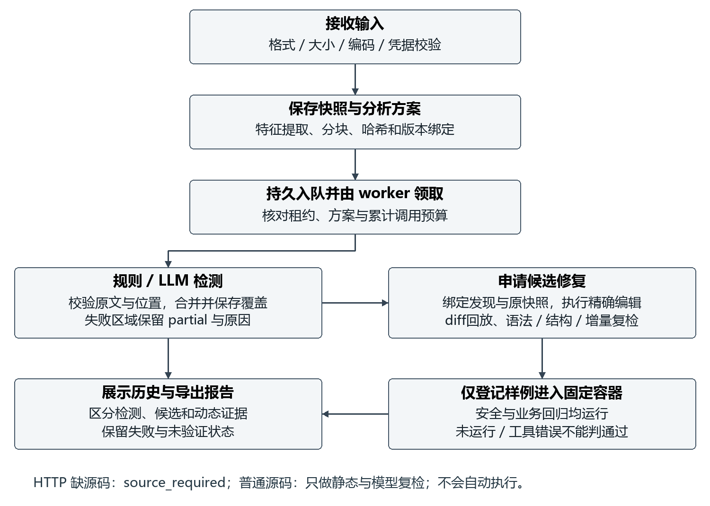
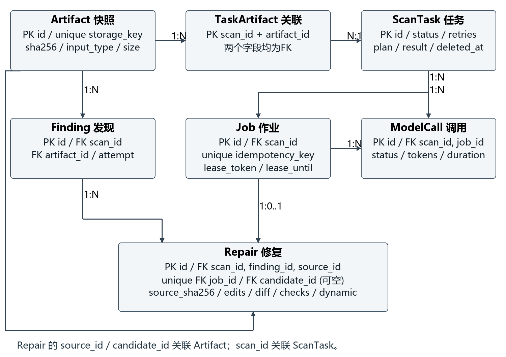

# 一 引言与实践目标

## 一 研究背景与问题描述

Web 程序经常需要把浏览器提交的数据写入页面、数据库查询或系统命令。当不可信数据进入这些解释环境时，输入中的特殊字符可能改变程序原本要表达的结构。跨站脚本使数据成为浏览器可执行内容，SQL 注入使参数成为查询语法，命令注入使参数进入操作系统命令解释过程。三类漏洞分别对应 CWE-79、CWE-89 和 CWE-78[1–3]。它们具有相似的输入到危险操作路径，但修复方式依赖输出上下文，不能用一种字符串过滤方法统一处理。

传统规则能够稳定找出危险函数和常见拼接模式，但要区分“出现危险函数”与“存在可达的不可信输入”，还需要分析变量定义、分支、转义位置及框架默认行为。人工审计可以理解业务约束，却需要逐条核对证据和补丁。大语言模型能够对源码作解释并生成修改建议，为这项工作提供辅助；模型同时会给出错误位置、重复发现和无法应用的补丁，因此系统不能直接把模型回答作为最终事实。

IRIS 将大语言模型与静态分析结合，用于推断分析所需的语义信息和进行上下文判断[4]。本项目采用相近的工程思路：规则提供可追溯线索，模型补充语义解释，服务端独立核对输出。我们没有实现 IRIS 的全仓库分析，也没有训练专用漏洞模型，而是围绕 Python Web 源码构建可运行、可检查的课程系统。

修复是本次实践的重要组成。VulRepair 展示了利用预训练代码模型生成漏洞修复的研究路线[5]，但生成的文本仍需要判断是否适用于当前源码。安全软件开发也需要在开发过程中加入检查、测试和漏洞响应活动[6]。因此，本项目将补丁生成、静态复检和受控动态测试分开记录，同时检查漏洞消除与正常功能保持。

## 二 实践目标与完成范围

本项目命名为“铸盾 AegisForge”，实现基于 LLM 的 Web 代码漏洞智能检测与修复工具。用户可以上传或粘贴 Python 源码、离线 HTTP 请求文本，查看特征、漏洞类型、风险等级、证据位置和修复建议；对支持的源码生成候选补丁，预览差异并下载；对登记样例执行固定的隔离验证；保存历史并导出分析报告。修复与验证作为课程加分项实际实现。

首版完整支持范围是 Python 3 和 Flask 风格 Web 代码。HTTP 请求仅进行离线攻击特征分析，不扫描站点、不重放请求，也不能凭请求载荷断言服务端存在漏洞。缺少源码时系统返回 source_required，不编造源码补丁。普通上传源码和模型生成代码均不在 API 或 worker 主机执行；动态执行只面向登记的固定样例。

截至本报告编写，系统已完成三类漏洞的真实模型检测、候选修复、容器安全及业务回归实验。原始联合源码三轮检测平均精确率约 59.22%、召回率约 98.15%，原三轮首次修复通过 36/54。实验后针对误报、定位和业务保持进行了改进，18 个后续候选在加强后的固定测试中全部通过。两组数据对应不同阶段与候选选择口径，本报告分别呈现，不将后续结果替换原始成绩。

# 二 需求分析与功能模块

## 一 用户场景与需求划分

系统面向本地单用户课程演示。主要场景是开发者提交一个待分析文件，选择规则、模型或联合分析，核对证据后决定是否申请候选修复。受控案例可进一步申请动态验证。系统必须清楚展示未完成、失败与未验证状态，避免用户将“没有显示发现”理解为“已经证明安全”。

表1 课程要求与系统交付映射

| 编号 | 需求 | 实现与验收方式 |
| --- | --- | --- |
| R01 | 文件上传 | .py 源码及 .http/.req/.txt 请求文本；格式、编码、大小和路径边界检查 |
| R02 | 特征提取 | Python AST、输入来源、危险操作、HTTP 字段及规范化特征 |
| R03 | 智能检测 | 规则、LLM、联合三策略；DeepSeek 真实实验与结构化证据校验 |
| R04 | 结果展示 | CWE、风险等级、原因、修复建议、来源、定位及覆盖缺口 |
| R05 | 候选修复 | 基于源码快照的精确编辑、候选源码、unified diff 与下载 |
| R06 | 修复验证 | 补丁、语法、结构、规则和模型复检；登记样例固定容器测试 |
| R07 | 历史与导出 | 查询、筛选、分页、逻辑移出及无源码的 JSON/Markdown 报告 |
| R08 | 工程交付 | conda 环境、锁文件、迁移、CI、源码、使用说明及本报告 |

## 二 系统功能模块划分

系统分为输入接入、特征与检测、任务调度、候选修复、受控验证、工作台与证据六个模块。输入接入把文件转为不可变快照；检测模块只接收经校验的快照视图；调度模块负责持久排队、取消和恢复；修复模块只修改与发现绑定的快照；验证模块由独立 runner 调用；前端通过 API 查询状态，展示来源与验证层次。



模块之间通过稳定 ID、内容摘要和数据库记录关联。原始文件名仅用于展示，不能作为存储路径。一个检测任务可以关联多个输入快照，一个发现可以有多个修复尝试，每个候选各自保留检查结果。这样可以在保留原始证据的同时比较后续尝试。

## 三 非功能需求与边界

可靠性方面，API 返回入队状态后即使重启，任务也应能由独立 worker 继续领取。作业通过租约和所有者令牌防止过期 worker 发布结果。模型失败时保留已经核对的发现，并标为 partial；取消、重试和超时都需要留下可解释记录。

安全方面，上传内容、模型输出和候选代码均视为不可信。系统限制输入尺寸与调用预算，对凭据进行尽力脱敏，模型密钥只从操作系统环境变量读取。API 与 worker 不拥有 Docker 管理权限。可用性方面，前端提供状态提示、绝对行号、键盘导航和移动端布局；动画支持暂停并尊重减少动态效果的系统偏好。

范围限制包括：不支持 ZIP、PCAP、任意项目安装依赖、公网多租户和账号权限体系；不保证完整跨函数、跨文件污点分析；不对任意上传代码提供执行沙箱。数据库中的逻辑移出不等于物理删除，这些限制在界面和使用说明中说明。

# 三 系统架构与配置设计

## 一 总体架构

系统采用前后端分离架构，后端为模块化单体，耗时检测和修复由独立 worker 完成。React 页面只访问 FastAPI；API 验证请求并写入 SQLite；worker 从数据库领取任务，读取受限存储中的快照，执行规则和模型分析后保存结果。模型服务通过固定 HTTPS 接口访问，浏览器不接触模型密钥。



受控验证 runner 独立于 API 和 worker，读取已登记的样例 ID、原文摘要和候选快照，使用固定 Docker 镜像运行冻结测试。它不接受模型给定的命令、镜像或测试路径。容器结果经过 nonce、候选摘要和固定测试名核对后，才能写回验证记录。普通上传即使可以生成候选，也不会因此获得动态执行资格。

## 二 技术选型与取舍

表2 主要技术选型

| 层次 | 技术 | 选择原因与取舍 |
| --- | --- | --- |
| 浏览器 | React、TypeScript、Vite、Ant Design | 组件化实现状态流与筛选；类型约束前后端协议，保留本地演示部署方式 |
| 服务端 | Python 3.13、FastAPI、Pydantic | 支持类型化接口、结构校验及 OpenAPI；模型自由文本不能跳过 schema |
| 数据 | SQLite、SQLAlchemy、Alembic | 部署依赖少、关系及迁移可追踪；首版单 worker，适用负载有限 |
| 任务 | 数据库作业表与独立 worker | 无需 Redis/Celery；代价是需要自行实现租约、幂等和恢复 |
| 检测 | Python AST 与 DeepSeek provider | 确定性规则便于解释，模型补充语义；真实模型与测试替身分离 |
| 修复 | 结构化行编辑及服务端 diff | 减少整文件重写，强制核对原文和修改范围 |
| 验证 | pytest、Playwright、固定 Docker runner | 分别检查服务逻辑、界面流程及候选实际行为 |
| 协作 | Git、GitHub Issues、PR、Actions | 按里程碑追踪实现、缺陷、证据和集成状态 |

前端源码对比使用项目实际实现的按行文本组件，保留绝对行号并将 DOM 窗口限制为 500 行；没有把计划中的 Monaco 选项写为已安装功能。SQLite 启用外键约束和锁等待配置，以短事务保存作业和结果。超过单机单用户负载后，需要重新评估数据库与任务队列方案。

## 三 运行环境与配置

开发机为 Windows x64，AMD Ryzen 9 7845HX，12 核心、24 线程，内存约 31.29 GiB。Python 使用 Anaconda 的 AegisForge 环境，实际实验版本为 3.13.18；Node.js 基线为 24.x。Python 运行时由 environment.yml 声明，后端库以 requirements 锁文件固定，前端使用 package-lock.json。所有主机 Python 命令均在该 conda 环境中执行。

表3 主要运行配置及默认边界

| 配置 | 默认值或约束 | 用途 |
| --- | --- | --- |
| API 与前端地址 | 127.0.0.1:8000、127.0.0.1:5173 | 本地演示，避免默认对公网开放 |
| 上传限制 | 2 MiB/文件，最多10文件，共10 MiB | 拒绝过大、空、二进制或不支持的输入 |
| 分析限制 | 80,000字符、最多8块 | 控制解析与模型上下文成本 |
| 模型与任务时限 | 默认60秒/调用、180秒/尝试 | 超时有界处理并保留覆盖缺口 |
| 调用次数 | 32次/任务，64次/部署每日 | 含重试累计；次数不等同费用 |
| 模型输出 | 128 KiB、最多4,096 token | 防止过大、截断或失控输出 |
| 作业队列 | 最多10个排队或运行作业 | 控制单 worker 压力 |
| 动态容器 | CPU 1、512 MiB、固定 PID/tmpfs限制 | 限制固定样例的执行资源 |

AEGISFORGE_MODEL_MODE、模型名称及本地访问令牌由配置读取；AEGISFORGE_DEEPSEEK_API_KEY 只从进程环境读取，刻意不作为可由 .env 提供的配置字段。源码、提示词、前端和仓库均不保存该密钥。.env、上传内容、数据库和原始模型日志位于 Git 忽略范围。配置漂移会导致已排队方案被拒绝执行，需要用户显式重试生成新方案。

# 四 流程与详细模块设计

## 一 检测与修复主流程

系统首先验证输入并保存快照，然后提取特征和分块。用户创建任务时确定策略、模型与分析方案。API 只入队；worker 获得租约后复核输入和方案摘要，依次处理所有预算内分块。通过校验的模型结果与规则线索合并后持久化，前端轮询显示任务状态、发现及覆盖缺口。



修复从一个具体发现出发。服务端核对发现属于当前任务尝试、源码摘要未变且编辑范围受支持，才允许模型生成行编辑。候选通过补丁回放、语法和结构检查后先保存，再进行规则及模型复检。若模型复检失败，候选可以保留为未验证；只有登记样例才允许申请固定动态验证。动态安全和业务测试共同通过后，页面才显示相应通过状态。

## 二 输入接入与特征提取

### 1 上传与快照存储

输入模块同时检查显式输入类型、扩展名、内容和编码。源码接受 .py，HTTP 接受 .http、.req、.txt；文本采用 UTF-8，兼容起始 BOM。空文件、二进制、压缩内容、路径穿越及超限输入被拒绝。文件按随机 ID 保存，原始文件名不参与路径拼接；读取时核对 SHA-256，避免待分析内容在排队期间被替换。

快照保存后，前端显示脱敏预览与特征。授权检查覆盖快照访问和任务查询，而不是仅在上传页面检查。尽力脱敏可以隐藏常见 Authorization、Cookie 和 API key，但不承诺识别任意编码或拆分的秘密。对于当前已配置的完整服务密钥，上传和模型发送路径另有精确字节检查，发现后直接拒绝。

### 2 Python 与 HTTP 特征

Python 解析器使用 AST 获取请求参数、危险调用、字符串拼接和输出位置等信息，并保留源码行号。语法解析失败时可以展示受限文本线索，但记录 ast_unavailable，不能假装完整语法分析成功。规则围绕输入来源、传播及危险汇点做有界判断，不执行导入或调用上传函数。

HTTP 解析器识别方法、路径、查询参数、请求头和正文，进行受大小和次数约束的规范化解码，并保留可追踪的字段位置。含攻击结构的字段形成 attack_indicator；只有请求文本时不产生可修复的服务端源码位置。LLM 只能引用实际存在的脱敏字段，不能编造后台文件名和行号。

## 三 规则与 LLM 联合检测

### 1 三种策略及覆盖账本

rules 策略只执行规则；llm 策略不向模型提供规则命中提示；hybrid 策略结合规则和模型。无论规则是否命中，都处理任务预算内的全部分块，防止只分析“规则已经怀疑”的片段。每块记录规则是否运行、AST 是否可用、模型是否成功或模拟、错误类别和发现数。覆盖账本说明哪里完成了分析，但不衡量结论是否正确。

当模型失败时，已经核对的规则发现仍可展示，任务标为 partial。fake provider 用于离线流程和普通 CI，页面明确标为模拟或部分完成。它不计入真实 LLM 检测证据，也不会把相同于原文的模拟候选称为真实修复。

### 2 模型协议与证据落地

DeepSeek 适配器通过固定 HTTPS 地址发送脱敏输入。提示词将源码表示为带全局行号的行列表，模型返回严格 JSON，包含 CWE、说明、建议和位置。服务端拒绝额外键、重复 JSON 键、非有限数字、截断输出和不完整结果。来源、完成状态、快照 ID 与验证状态由服务端决定，模型无权声明自己已通过测试。

源码证据必须逐字存在于脱敏输入，声明范围必须与实际证据相交。多义证据、过宽区间及错误位置按独立类别拒绝。一次有界纠正只返回固定失败类别和位置事实，不放宽原文相等规则。HTTP 证据同样必须对应已存在字段。模型说明与建议在展示前再次脱敏，源码证据不被自由文本脱敏器改写。

### 3 同流合并与语义复核

最初仅合并相同文件、CWE 和重叠位置的发现。后续增加同一输入到汇点的同流合并，减少规则与模型用不同区间描述同一风险造成的重复报警。合并后保留 contributors，便于查看原始来源、位置和判断分歧，不能只留下一个没有来由的风险分数。

实验后的静态复核针对可明确证明的安全上下文，例如已参数绑定的 SQL 值、在当前上下文正确使用的转义以及危险调用之前的可达定义。复核结果及理由保留，不能按测试样例 ID 或标签过滤。该方法仍是有界启发式；当别名或容器变更不能被证明安全时，应保守保留线索。可变列表曾被误当作常量，造成一次真实漏报，后续增加已知变更及简单别名处理，相关失败在实验部分单独保留。

### 4 三类漏洞的判断与修复原则

XSS 检查请求值是否进入页面输出，以及输出处属于 HTML 文本、属性、URL 还是 JavaScript 数据。HTML 文本中的正确转义不能自动证明脚本字符串安全；常量模板加变量参数与将输入拼进模板源码也不同。修复需在实际输出上下文处理数据，同时保留普通引号、Unicode 和预期显示结果。

SQLi 检查输入是否参与 SQL 语句结构。绑定值参数是常见修复方式，但表名、列名和排序方向一般需要固定白名单，不能用值占位符替代标识符。整数转换只限定相应数字值，并不保护其他仍被拼接的字段。动态测试还要检查合法更新及失败请求的原子性，避免只靠禁用功能消除注入。

命令注入检查数据是否进入 shell 解释文本。参数数组与 shell=False 可以减少解释层，但显式 sh -c、可控选项或其他危险程序仍需单独判断。若业务确实需要管道或重定向，修复必须逐项处理输入并保持备份等业务结果，不能只删除重定向后返回成功。上述原则用于约束规则解释与候选审查，不代表系统已完整证明所有传播路径。

## 四 任务调度与可复现凭证

API 把 ScanTask 与 Job 在事务中写入数据库，独立 worker 通过原子事务领取 queued 作业，记录 lease_token、lease_until 和心跳。结果发布前再次检查所有者令牌，防止旧进程在租约失效后覆盖新尝试。队列、创建频率和重试次数都有边界，长模型调用期间通过协作式取消处理超时和用户取消。

表4 检测任务状态与含义

| 状态 | 含义 | 页面解释 |
| --- | --- | --- |
| queued | 已持久入队 | 等待独立 worker |
| running | 当前有效租约执行中 | 显示进度与调用次数 |
| completed | 本次所请求分析完成 | 仍只是静态分析结论 |
| partial | 存在未覆盖或失败区域 | 查看覆盖缺口，不据空结果判安全 |
| failed | 任务无法完成 | 返回稳定错误码，不回显内部异常 |
| cancelled | 用户取消或取消生效 | 已有调用仍计入预算 |

每次尝试保存输入摘要和分析方案摘要。输入摘要绑定类型、内容哈希及重复数量，方案摘要还绑定分块、策略、模型名、规则/提示词/解析/脱敏版本与输出参数。重试归档旧发现和旧凭证，不删除原记录，也不重置调用预算。凭证能帮助核对“分析了什么、用什么方案”，但没有数字签名，不证明模型正确，也不能保证供应商更新后的相同名称输出完全一致。

## 五 候选补丁生成与静态复检

### 1 编辑协议及补丁回放

修复请求绑定 finding_id、source_sha256 和当前检测锚点。首版修复限受支持的单块 Python 快照；含脱敏替换的源码拒绝自动修复，避免将凭据占位符写回代码。模型返回 start_line、end_line、old_text、new_text 等有界编辑，服务端验证范围、顺序、重叠、原文逐字相等和换行，随后生成候选及 unified diff。

服务端再用严格 diff 应用器回放补丁，要求回放结果与候选逐字一致。缺末行换行有明确标记，非法编码及控制字符被拒绝。该过程避免“页面展示的 diff”与“实际下载的候选”不一致。原快照始终保留，系统不会自动覆盖用户项目文件。

### 2 结构与风险增量检查

通过 AST 比较检查函数定义、参数和装饰器等结构，拒绝删除入口、改签名、增加 eval/exec 等高风险行为或超范围整体重写。实际行差异用于映射修复前后的发现，分别记录目标仍在、其他原有风险和新增风险，避免仅因同文件还有另一处同类问题就把目标修复判为失败。

候选与检查记录分阶段落库。即使随后模型复检超时，用户仍能看到已生成候选及未完成原因；父检测已经重试的旧修复会标记为过期，不能继续新验证。生成成功、静态检查通过、模型复检通过和动态测试通过是四种不同证据，界面不合并为一个不透明的“修复成功”。

### 3 门禁账本与修复说明卡

门禁账本逐项展示语法、补丁、结构、规则目标/新增、模型目标/新增、动态安全/业务检查。状态包括 passed、failed、pending、skipped 和 error。确定失败优先标为失败，工具错误不能伪装通过；缺少动态证据保留 unverified。修复说明卡概括改动行数、检查完成数、剩余风险和执行契约，帮助用户判断候选是否值得人工采用。

## 六 受控动态验证

runner 先核对登记 ID、原始源码摘要及候选摘要，再以固定入口启动验证镜像。候选只能作为待测源码，不能改变测试脚本或控制容器参数。容器禁止外网、以非 root 用户运行、根文件系统只读、删除全部 capability，并设置 no-new-privileges、CPU、内存、进程数、tmpfs、输出和时间限制。API、worker 与测试容器均不持有 Docker socket。

容器中 driver 持有断言和浏览器，target 只加载候选并提供回环 HTTP。driver 在运行候选前设置不可转储属性，失败则停止，减少同 UID 进程读取判分通道的机会。候选输出不进入结果通道，driver 仅输出带宿主一次性 nonce 的固定 JSON。宿主核对候选摘要、固定测试名、nonce 和退出状态后才接收记录。

XSS 使用真实浏览器判断脚本是否执行，并检查正常文本输出；SQLi 检查是否越过查询边界及正常引号输入；命令例运行真实 shell，通过无害标记和正常结果判断执行边界，外部实用程序采用固定离线桩。验证范围因此有限：容器并非完全隔离的多租户平台，浏览器使用 --no-sandbox，命令桩也不能代表所有真实工具行为。通过仅说明本次固定测试通过。

## 七 前端工作台与报告导出

前端按输入、检测、证据、候选及历史组织页面。发现支持按 CWE、等级、来源和证据状态筛选，筛选在服务端执行；源码窗口限制 500 行并保留绝对行号，支持上下移动、N/P 跳转和 Enter 查看证据。布局适配桌面及手机，动态装饰允许暂停，减少动态效果偏好优先。

历史中的“移出”是逻辑操作：关闭任务及关联发现/修复入口，但保留账务和共享输入，避免删除记录重置预算。活动任务不能移出。JSON/Markdown 导出采用字段白名单，不默认包含源码、文件名、HTTP 私密字段或模型自由文本。报告摘要用于一致性检查，不是数字签名；Markdown 叙述文字不在 JSON 摘要保护范围。

# 五 数据库与接口设计

## 一 数据库概念结构

数据库围绕输入快照、检测任务、作业、发现、模型调用和修复记录建立关系。Artifact 与 ScanTask 是多对多，通过 TaskArtifact 关联；ScanTask 有多个 Job、FindingRecord、ModelCall 和 Repair；Repair 关联目标发现、原始 Artifact、候选 Artifact 及唯一修复 Job。候选也作为 Artifact 保存，因此可以复用快照完整性检查。



## 二 数据库逻辑结构

表5 主要数据表及关键字段

| 数据表 | 主键与关联 | 主要字段及作用 |
| --- | --- | --- |
| artifacts | id；storage_key唯一 | input_type、sha256、size_bytes、display_name、created_at；不可变输入/候选 |
| scan_tasks | id | status、strategy、model_alias、result_json、plan_json、attempts_json、deleted_at |
| task_artifacts | scan_id与artifact_id联合主键 | 关联检测任务和输入；源码删除受引用约束 |
| jobs | id；scan_id外键；idempotency_key唯一 | kind、status、attempts、lease_token、lease_until、heartbeat_at |
| findings | id；scan_id与artifact_id外键 | payload、attempt、position；保存结构化发现和稳定排序 |
| model_calls | id；scan_id与job_id外键 | model、status、prompt_version、duration_ms、token计数、failure_category |
| repairs | id；finding/source/candidate/job关联 | source_sha256、anchor、edits_json、diff、checks_json、dynamic_json |

状态、策略和输入类型使用 CHECK 约束；跨记录关联使用外键。快照被引用时采用 RESTRICT，防止误删证据；任务下从属记录采用相应级联策略。逻辑移出只写 deleted_at。时间统一采用带时区语义的 UTC，落库前转为 UTC，读取后恢复时区。迁移按 Alembic 逐版追加，不修改已执行的历史迁移。

关系字段保持基本规范化，体量较小且版本变化频繁的覆盖、计划和检查结果放在 JSON 文本字段中，由 Pydantic 及服务层验证。这降低了课程系统迁移复杂度，但大规模统计查询会受到限制，未来可以把高频分析字段拆为独立关系表。

## 三 API 与错误设计

表6 主要接口设计

| 方法与路径 | 输入或行为 | 结果 |
| --- | --- | --- |
| POST /api/v1/artifacts | 原始文件字节；filename与input_type查询参数 | 201；快照及脱敏预览 |
| GET /api/v1/artifacts/{id} | 快照ID | 鉴权后读取受限视图 |
| POST /api/v1/scans | 快照列表、策略、模型 | 202；持久排队任务 |
| GET /api/v1/scans/{id}/findings | CWE/等级/来源、分页 | 发现、来源和定位 |
| POST /api/v1/scans/{id}/retry | 显式重试 | 202；归档旧尝试，重新生成方案 |
| POST /api/v1/repairs | 发现、源码摘要、模型 | 202；候选修复作业 |
| GET /api/v1/repairs/{id}/compare | 修复ID | 原文/候选窗口及发现增量 |
| GET /api/v1/repairs/{id}/download | 候选或补丁类型 | 受限文本下载 |
| POST /api/v1/repairs/{id}/validate | 登记修复ID | 202；请求独立受控验证 |
| GET /api/v1/workspace/{id}/report | JSON或Markdown格式 | 脱敏白名单报告 |

除公开健康信息外，业务接口使用 Bearer 令牌。API 对客户端暴露 request_id、稳定错误码和可操作提示，不回显内部异常、文件路径或模型原始回答。创建任务支持幂等键；相同发现的活动修复复用已有作业。所有路径 ID、分页和筛选条件均先校验，SQL 查询使用 ORM 参数化方式。

以下是接口处理顺序的等价伪代码，用来说明责任边界，非未经测试的新入口：

```text
create_scan(request):
    authenticate_and_validate(request)
    snapshots = load_and_verify_hashes(request.artifact_ids)
    plan = bind_input_strategy_versions(snapshots, request)
    with transaction:
        reuse_idempotent_job_or_insert_scan_and_job(plan)
    return 202, scan_id

publish_result(job, result):
    with transaction:
        require_current_lease_and_attempt(job)
        persist_validated_findings_coverage_and_receipt(result)
```

# 六 实现过程与使用说明

## 一 实施阶段与关键改进

项目按 M1 至 M7 组织。M1 建立前后端、conda、迁移和 CI 基础，并完善科技感界面与减少动态效果支持；M2 完成上传、脱敏、解析、规则和数据冻结；M3 接入 DeepSeek、持久 worker、严格证据校验、覆盖账本与检测凭证；M4 完成候选、diff、静态/模型复检和隔离验证；M5 补全历史、筛选、证据导航及报告；M6 运行实验并依据失败改进；M7 汇总为本课程报告和交付材料。

实现中最明显的困难是模型文本与程序证据的衔接。直接要求模型自行数行会出现证据存在但行号错误，直接要求完整替换又容易造成 old_text 冲突。后续将源码显式行寻址，复用服务端补丁预检，并只进行一次带事实的纠错。另一类困难是修复业务保持：消除危险调用仍可能破坏重定向、合法字段更新或正常输出，因此必须加入业务断言。

前期采用过 Codex 与 Claude 的开发/审查协作，协作记录保留在仓库；后期因账号问题按项目约定改为独立完成，不把未执行的协作写为完成。AI 参与实现和文稿辅助不替代人工复核、课程查重及最终提交责任。

## 二 安装与启动

新环境先从 GitHub 获取完整仓库，在项目根目录创建并激活 AegisForge 环境，安装锁定依赖并初始化数据库。下列命令是项目已有启动流程，不包含真实模型密钥：

```text
conda env create --file environment.yml
conda activate AegisForge
python -m pip install -r backend/requirements-dev.lock
npm --prefix frontend ci
python scripts/dev.py init
python scripts/dev.py migrate
```

分别在三个终端启动 API、worker 和前端：

```text
conda run --no-capture-output -n AegisForge python scripts/dev.py api
conda run --no-capture-output -n AegisForge python scripts/dev.py worker
npm --prefix frontend run dev
```

打开 http://127.0.0.1:5173，输入初始化生成的本地访问令牌。令牌只保留在页面内存，刷新后重新连接。默认 fake 适合离线演示；启用真实检测时，将模型密钥配置为操作系统环境变量，并令 API 与 worker 继承同一环境。真实调用会计入预算，课程演示前应核对剩余额度。

## 三 检测与证据查看

选择 Python 源码或 HTTP 文本，上传文件或粘贴内容后点击“保存并预览特征”。核对脱敏预览，再选择策略和模型创建任务。queued 长时间未变化时首先检查独立 worker 是否启动；partial 应展开覆盖账本，确认失败块及原因。查看发现时结合 CWE、证据、来源和上下文，不能仅凭风险等级下结论。


图5来自 M6 Chromium 的离线 CI 页面，展示输入预览与规则线索。该截图使用 fake provider，只证明界面及离线流程；其历史版本标识保留，不当作本次真实模型输出。真实检测数值来自第八章的模型实验记录。


图6为 M4 三类真实开发演示中的 XSS 案例，显示 DeepSeek 已完成一个分块并与规则发现合并。它用于说明真实交互链，不代表最终版本在所有样例上的准确性。证据行和覆盖信息可以让用户核对模型是否分析了目标区域。

## 四 候选修复与验证操作

在支持的源码发现中申请候选修复，等待 worker 生成。先查看修复说明、原文/候选差异与各项门禁，再下载补丁。普通上传只显示已有静态与模型证据；登记案例才可申请动态验证，且需要在具备 Docker 的受信环境单独运行 runner。Docker 不可用时应保留 error 或未验证，不能把“请求已提交”当成测试通过。


图7保留 M4 实际候选的 diff、九项门禁及固定测试名。该例对 HTML 文本输出使用 MarkupSafe 转义并保持正常问候输出；此做法不能推广为 JavaScript 字符串或任意 URL 上下文的统一修复。是否适用于目标代码仍需检查上下文。

## 五 历史导出与常见问题

历史页支持分页和条件筛选，可打开旧任务、查看当前及归档修复，下载 JSON 或 Markdown 报告。导出不含原始源码和私密字段；可用 scripts/verify_report.py 核对 JSON 内容摘要。逻辑移出前需要结束活动作业，它不会擦除磁盘快照或清空预算。


出现 MODEL_INVALID_OUTPUT 时查看稳定失败类别，而不是绕过证据校验；出现 PATCH_CONFLICT 时核对源码快照与原文范围；出现 ANALYSIS_CONFIG_CHANGED 时显式重试；只有 HTTP 输入时补充对应源码后再申请修复。需要真正删除本地数据时，应另外制定清理与引用回收流程，不能用“移出历史”代替。

# 七 安全性分析

## 一 威胁模型与检测机制优势

本系统同时处理两类风险：待检测程序的漏洞，以及分析平台接收不可信内容造成的自身风险。攻击者可能提交带路径穿越或秘密的文件，在源码注释中加入提示注入，诱导模型编造位置或生成越权补丁，或让候选程序试图伪造动态结果。模型服务及网络故障也可能造成不完整结论。

规则的优势是确定性、位置可核对且不依赖外部服务；模型的优势是解释上下文和提出候选修改。联合机制通过保留来源、严格证据落地和显式覆盖状态，让用户可以检查二者分歧。语义复核只在静态条件足够时给出可见理由，而不因模型“很自信”就隐藏报警。代价是保守处理仍会产生误报，模型也可能漏掉系统无法表达的传播路径。

## 二 输入与提示注入防护

文件名、扩展名和 MIME 都不单独作为信任依据。输入尺寸、编码、路径、正文及摘要核对共同约束接入边界。HTTP 请求只解析，不对外发送，减少将恶意载荷转化为网络动作的机会。前端用文本展示源码和模型内容，避免将待审 XSS 片段直接插入 HTML。

源码和请求内容在模型上下文中明确作为数据，系统不授予模型工具执行、数据库查询或任意网络能力。即使提示注入影响了回答，返回值也必须通过 schema、位置、原文及补丁权限检查。上述机制限制可造成的后果，但不能证明模型永远不受提示注入影响，因此候选仍需人工审阅与测试。

## 三 数据与密钥保护

DeepSeek 密钥只存在操作系统环境及必要子进程内存中，不进入前端、源码、.env 或 Git。模型调用元数据保存状态、耗时、token 和失败类别，不保存原始回答。常见请求秘密在展示、模型发送和导出前脱敏；输入中含当前完整服务密钥时拒绝分析。未知凭据、编码凭据和同用户其他进程读取环境变量仍属于剩余风险。

API Bearer 令牌、回环监听、来源限制和受限文件存储适用于本地单用户场景。它们不提供公网多租户身份隔离。报告和快照摘要能够核对内容一致性，缺少数字签名及独立可信时间戳，不能抵御具有仓库与主机写权限的攻击者同时篡改全部记录。

## 四 修复及执行边界

补丁协议将修改绑定到原快照，限制行范围、原文、语法和结构，降低模型删改业务入口或引入执行能力的风险。规则/模型增量复检能够发现部分新风险，但仍只是静态判断。动态安全测试与正常功能测试共同运行，防止“把功能删掉”被误判为修复。

独立 runner 和容器限制保护主机执行边界。资源探针实际检查了内存、进程、只读根目录、非 root、无外网和无 Docker socket。仍需保留容器内同 UID、Chromium 禁用自身 sandbox、命令桩和固定小样例的局限。未来若扩展到任意用户代码，应采用更强的隔离、独立身份、系统调用与文件访问约束，重新设计执行服务。

## 五 供应链与可靠性

项目固定 Python/npm 锁文件和 Docker 镜像摘要，数据库以追加迁移演进，普通 CI 不消费真实模型密钥。依赖审计曾发现验证镜像 Flask 3.1.2 的一项低危公告，升级至 3.1.3 并重新生成锁；当时 45 个锁定 Python 包审计无已知公告，npm 审计为零。这只是审计时点和所查依赖范围内的结果，不覆盖操作系统包或未知漏洞。

持久预算、租约与幂等控制避免重启导致重复执行或预算清零。模型超时、无效输出和工具失败各自记录，错误不回显私密正文。数据库锁和同步清理存在有限等待，180 秒任务期限属于协作式控制，不能当成实时系统的绝对截止保证。

# 八 测试方案与实验结果

## 一 实验问题与数据设计

实验围绕四个问题展开：规则、LLM 与联合策略在三类漏洞上有何差异；模型输出能否形成可用补丁；补丁是否同时满足安全与业务约束；系统在边界、故障、界面和有限并发下能否稳定运行。测试区分服务逻辑、模型真实性、候选实际行为和记录完整性，避免使用一种测试替代另一种结论。

数据共 180 条，其中源码 120 条、HTTP 60 条。开发集 72 条，包含源码 48、HTTP 24；初始保留集 108 条，包含源码 72、HTTP 36。按家族划分，初次实验前冻结 ID、标签、源码摘要与用途，漏洞与安全配对不跨集合。保留源码中每类有 12 个漏洞和 12 个安全例；HTTP 每类有 6 个攻击特征例和 6 个正常例。18 个受控修复目标属于这 72 条保留源码，每类 6 个，不能额外当成独立检测样本。

标签初始由 AI 辅助编写，后经一名人工评审复核；不等同于多人独立金标准。数据规模小、合成模式多，只覆盖课程定义的有限输入。数据质量及重复会影响漏洞模型评价，这也是已有数据质量研究强调的问题[7]。看到基线结果后再修改检测和修复逻辑，原保留集即成为已暴露材料，后续只能称事后回归或定向诊断。

## 二 分层测试方案

表7 测试层次与主要用例

| 层次 | 测试内容 | 判定依据 |
| --- | --- | --- |
| 解析与输入 | 编码、空/超大输入、路径、HTTP规范化、脱敏 | 拒绝非法输入，位置与摘要稳定 |
| 规则与模型协议 | 三类正反例、遮蔽/别名、错误JSON、伪造证据 | 来源真实，错误不转为成功 |
| 队列与存储 | 幂等、取消、租约失效、重试、预算并发 | 无过期发布，账务累计且可恢复 |
| 补丁服务 | 越界、重叠、原文冲突、换行、结构、diff回放 | 候选与下载补丁一致，范围受限 |
| 真实模型 | 规则1轮、LLM与联合各3轮；修复3轮 | 完整计入失败与未检出，不以fake补齐 |
| 隔离动态 | 漏洞/安全对照、首次候选、后续候选、部分修复 | 固定安全及业务测试，环境错误单列 |
| 前端与浏览器 | 筛选、导航、历史、导出、手机布局 | 真浏览器流程，保留显式skip和截图 |
| 非功能 | API负载、真实时延、50KiB边界、资源/依赖 | 描述测量条件及范围，不外推保证 |

真实模型实验使用 deepseek-flash，temperature=0，thinking disabled，输出最多 4,096 token；模型不支持的 seed 记为不适用。调用采用持久账本预留，所有重试计入项目 1,000 次上限。temperature=0 不代表远端服务完全确定，因此 LLM 和联合重复三轮。普通 CI 采用 fake，仅验证工程流程，真实实验结果另存摘要。

## 三 指标与统计口径

源码漏洞按位置与 CWE 匹配发现。TP 为匹配到真实目标的发现，FP 包括安全例报警、重复、错误类型或位置，FN 为未检出的漏洞。任务失败不会被删除：目标未发现仍计 FN。精确率、召回率与 F1 使用以下定义，三轮结果逐轮报告，并计算相同口径的均值。

```text
Precision = TP / (TP + FP)
Recall    = TP / (TP + FN)
F1        = 2 × Precision × Recall / (Precision + Recall)
```

HTTP 指标仅评价离线攻击特征，不称为服务端漏洞检测率。修复以每次预定尝试为分母，未检出、补丁冲突及缺动态证据均保留。通过要求候选能够应用、规定的复检完成，并在固定容器通过安全和业务测试。生成成功率与动态成功率分别统计，避免只在成功生成的候选中计算造成偏高结论。

## 四 原始检测实验

实际通过上传 API、任务队列、worker 和查询接口运行规则 1 轮、LLM 与联合各 3 轮，共 756 个任务，其中 648 个任务需要真实模型检测。外部检测请求 695 次，625 次成功响应、66 次无效输出、4 次传输失败。失败没有由模拟输出补齐。

表8 原始源码检测结果

| 策略及轮次 | TP | FP | FN | Precision | Recall | F1 |
| --- | --- | --- | --- | --- | --- | --- |
| 规则 | 30 | 10 | 6 | 75.00% | 83.33% | 78.95% |
| LLM 第1轮 | 32 | 19 | 4 | 62.75% | 88.89% | 73.56% |
| LLM 第2轮 | 32 | 20 | 4 | 61.54% | 88.89% | 72.73% |
| LLM 第3轮 | 33 | 22 | 3 | 60.00% | 91.67% | 72.53% |
| 联合第1轮 | 35 | 24 | 1 | 59.32% | 97.22% | 73.68% |
| 联合第2轮 | 36 | 24 | 0 | 60.00% | 100.00% | 75.00% |
| 联合第3轮 | 35 | 25 | 1 | 58.33% | 97.22% | 72.92% |

联合源码三轮平均 Precision 为 59.22%、Recall 为 98.15%。每类平均召回率分别为 XSS 100%、SQLi 94.44%、CMDi 100%。与规则相比，联合策略少漏报，但引入更多误报；不能仅因召回高就称检测效果全面优于规则。三轮共 73 个 FP 中，59 个位于安全源码，14 个是重复发现，说明安全上下文判断和合并粒度均需改进。

按类别计算的联合三轮平均 Precision 分别为 XSS 65.50%、SQLi 60.74%、CMDi 52.96%。CMDi 的三轮 FP 共32个，高于 XSS 的19个与 SQLi 的22个，表明命令调用的安全参数语义是本批材料中最需要减少误报的方向。这些是相同冻结基线的分类统计，不与后续候选通过率混为同一指标。

原规则 HTTP F1 为 0.5；LLM 和联合的 HTTP 每轮均为 TP18、FP0、FN0，F1=1。该结果只对应每轮 36 条合成离线请求，正例特征较明确，不能推断真实网站检测能力。仅凭请求缺少服务端数据流、权限和执行上下文，必须与源码及后续验证结合。

## 五 原始首次修复实验

18 个固定目标各运行 3 轮首次修复，共 54 次预定尝试。生成候选 38 次，14 次 PATCH_CONFLICT，2 次 TARGET_NOT_DETECTED；生成和模型复检另消耗 90 次请求。候选在真实 Docker 中运行固定测试，38 个候选中 36 个通过，2 个 XSS JavaScript 字符串候选破坏正常业务。

表9 原始首次修复有效性

| 类别 | 预定尝试 | 综合通过 | 通过率 |
| --- | --- | --- | --- |
| XSS | 18 | 16 | 88.89% |
| SQLi | 18 | 8 | 44.44% |
| CMDi | 18 | 12 | 66.67% |
| 合计 | 54 | 36 | 66.67% |

逐轮综合通过为 12/18、13/18、11/18。若仅看已生成候选，动态通过为 36/38，但这会掩盖 16 次未形成候选的尝试，因此本报告以 36/54 作为首次修复结果。SQLi 结果较低主要关联生成与应用阶段失败，不能简单解释为模型完全不理解参数绑定。14 次原文冲突的全部线协议根因未被逐一证实，后续行寻址和预检属于针对该问题的结构性改进。

## 六 实验后优化与定向结果

基于错误分类，后续改进显式行号、精确原文预检、带事实的单次纠错、同流合并、可达定义与安全上下文复核，并在修复提示中加入正常业务约束。开发集 A/B 各 48 个任务，共 99 次调用，源码 TP12 不变、FP5降至3，Precision 由约70.59%升至80%；行号拒绝由2次降至0。它只是一轮开发诊断，不能当作新的保留集结论。

表10 后续结果及其解释范围

| 实验 | 实际结果 | 解释范围 |
| --- | --- | --- |
| 原记录最终静态重建 | 三轮36/6/0、36/6/0、36/7/0；P均值85.05%、R100% | 旧模型位置的事后重建，非新模型三轮 |
| 真实定向首批 | TP11、FP0、FN1；动态11/12 | 暴露数据上的单批定向实验 |
| 漏报修正后补充 | TP1、FP0、FN0；动态1/1 | 独立补测记录，不回填首批失败 |
| 18个后续候选加强验证 | 18/18；每类6/6 | 不同生成版本的后续候选，非首次率 |

真实定向实验中，SQLi 的可变列表被静态复核错误当作常量，导致 LLM 线索被错误反驳。修复通过跟踪已知列表变更和简单别名，另运行漏洞/安全配对检测及一个候选复验。首批 11/12 与补充 1/1 分开记录；把两批合成“首批12/12”会掩盖缺陷。

最终静态重建使用归档模型位置，缺少当初完整自由文本和贡献区间，因此只评价现有规则、合并与复核对旧记录的处理。第三轮精确率仍约83.72%，即使三轮均值约85.05%，也不能写为每轮均达到85%。最终 adjudication-1.3 的保守证明加固完成离线回归，未重新付费运行完整统一版本三轮。

## 七 人工复核与测试判据补强

一名人工评审对冻结版本完成全部 180 条检测复核，其中179同意、1分歧；另审查属于原样本子集的18条动态判据，15同意、3分歧。共出现4项需处置的问题，无不确定记录。评审未重新执行容器测试，只有一名签署者，因此不称为双人独立复现，也不把18条动态记录当成额外18个检测样本。

表11 人工复核发现与处理

| 问题 | 处理 | 验证作用 |
| --- | --- | --- |
| 模板源码注入分类 | 另记CWE-1336根因与CWE-79网页影响，保留旧评分 | 区分根因与后果，不宣称新增完整SSTI检测 |
| XSS脚本元素终止 | 增加终止script后触发事件的固定载荷 | 检查JS/HTML边界处理 |
| SQLi业务字段 | 增加email/timezone及混合非法字段的原子拒绝 | 防止删除合法更新功能或部分写入 |
| 备份落盘语义 | 检查实际备份文件内容与重定向 | 防止只返回成功文本而未完成业务 |

新增验证镜像在原 driver 上叠加补充断言，原始八个 validator 文件保持不变。36 个漏洞/参考安全对照全部被正确判别；3 个故意不完整的修复在旧测试通过、在新测试失败，说明补充断言确实发现原测试缺口。随后对18个登记目标按预先确定的最新已安排尝试优先级选候选，失败行也不能退回旧成功行；加强验证18/18通过。

这些候选来自不同时间的 mutation、targeted 和 posthoc 记录，选择依据不是读取成功标志后挑选。结果能够证明这些具体后续候选满足加强后的固定测试；不能证明原首次修复达到100%，也不能代表新模型版本的独立泛化能力。

## 八 性能可靠性与兼容性

表12 工程测试与性能观察

| 项目 | 结果 | 条件与限制 |
| --- | --- | --- |
| API读请求 | 10并发、100次；p95约157.38ms，非预期错误0 | 回环HTTP、fake环境，不含真实模型时延 |
| 任务提交 | 另10次并发提交均202 | 与100次读请求为两组观测 |
| 真实短任务 | 5个91字节任务，约2.3至4.9秒 | 单数据库、顺序任务、当时网络 |
| 边界输入 | 50 KiB、5块，12.113秒、5次模型调用 | 固定合成输入，不代表全部大文件 |
| 本机后端 | 513通过、1平台跳过 | Windows符号链接权限导致跳过 |
| 远端后端 | Ubuntu及Windows各514通过 | M6最终普通CI，无跳过 |
| 前端 | 56通过；类型检查与构建通过 | 含快速键盘及StrictMode回归 |
| 浏览器 | Chromium5通过/1显式真实模型skip；Firefox1通过 | Firefox仅核心冒烟，非完整功能覆盖 |
| 核心分支覆盖 | services/parsers/rules为1263/1574，约80.24% | 前一轮核心源码测量，不含本轮新增控制器 |

资源实验确认了内存和 PID 上限、只读根目录、tmpfs、非 root、无外网和无 Docker socket。浏览器 CI 曾因 Ubuntu 包源 DNS 无法解析，在安装阶段超时，测试并未运行；后改用与项目 Playwright 版本一致且固定摘要的官方浏览器镜像。该受信 UI 测试容器与运行候选的无网络验证容器使用不同权限边界，没有因安装问题放宽候选执行限制。

原始检测、修复及性能合计795次外部调用；开发A/B、后续修复及定向开发回归增加147次；后续定向修复和补充验证增加50次，最终累计992/1000，剩余8次未使用。M6收尾与本报告写作未增加 DeepSeek 调用。费用缺少账单依据，记为不适用，不用次数推测真实金额。

## 九 结论有效性与课程验收

原计划中的85%精确率、修复率等为项目自行设置的参考目标，课程文件没有硬性数值阈值。原始联合精确率和首次修复总数没有达到原参考目标，这一事实保持不变。M6按课程功能、真实实验、失败分析、人工复核处置与工程证据完整性完成；显式 course-delivery-v1 验收通过，默认 strict 参考目标核对仍返回未达标。两种结果评价的对象不同。

内部有效性受小样本、合成数据、单人标签复核、固定测试及外部模型漂移影响。后续优化看过原结果，没有新的未暴露集，不能给出独立泛化结论。动态样例的实用程序桩、固定业务断言和参考实现自身边界限制外部有效性。报告中的通过率均保留实际分母、失败与版本范围，不将“通过本次测试”扩大为“程序没有其他漏洞”。

# 九 总结与改进方向

## 一 实践总结

本次实践完成了从输入、特征提取、LLM 检测、可视化展示到候选补丁和验证的 Web 流程，覆盖 XSS、SQLi 和命令注入三类课程要求。修复加分项交付了候选源码、可回放 diff、规则与模型复检以及固定容器的安全和业务测试。历史、导出、调用预算和证据凭证使结果能够追溯到具体输入、方案和尝试。

实验说明，模型提高召回并不自动带来高精确率，补丁可生成也不等于能够安全采用。原始联合策略误报较多、首次修复只有36/54，是本项目需要解释的实际结果。基于这些失败，显式行寻址、精确预检、同流合并与业务断言改善了后续诊断表现；人工复核进一步发现原动态测试的覆盖缺口。相比单纯展示模型回答，这些检查使系统更适合用于辅助审计和课程演示。

## 二 后续改进

首先建立新的未暴露样本，由至少两名独立评审核对标签和业务预期，在冻结最终版本后重复真实检测与首次修复实验。数据应增加真实项目中的跨函数传播、复杂别名、模板与数据库方言，按项目家族划分，避免相似改写跨集。当前的18/18后续候选结果可作为回归基线，不能代替这项工作。

其次改进可达定义和上下文建模，为静态复核增加可解释的证明范围，无法证明时保守保留发现；完善补丁业务契约，细化新增风险和结构变化解释。可扩展到更多框架与漏洞，但应先为新范围增加源码、安全配对和固定测试，避免只增加 CWE 名称而没有有效检测能力。

工程方面，可在有负载证据后升级数据库和任务队列，实现物理删除及引用回收，增加报表签名和更完整的依赖审计。若开放任意代码执行，需要先重构隔离服务并解决同 UID、浏览器沙箱和网络边界。前端可继续优化长文件按需加载和包体积，在保持键盘与无障碍交互的基础上减少初始加载成本。

# 参考文献

[1] MITRE. CWE-79 Improper Neutralization of Input During Web Page Generation[EB/OL]. [2026-11-13]. https://cwe.mitre.org/data/definitions/79.html.

[2] MITRE. CWE-89 Improper Neutralization of Special Elements used in an SQL Command[EB/OL]. [2026-11-13]. https://cwe.mitre.org/data/definitions/89.html.

[3] MITRE. CWE-78 Improper Neutralization of Special Elements used in an OS Command[EB/OL]. [2026-11-13]. https://cwe.mitre.org/data/definitions/78.html.

[4] LI Z, DUTTA S, NAIK M. IRIS: LLM-Assisted Static Analysis for Detecting Security Vulnerabilities[C]//The Thirteenth International Conference on Learning Representations. 2025. https://proceedings.iclr.cc/paper_files/paper/2025/file/582d4e27fa24168f3af1f4582655034b-Paper-Conference.pdf.

[5] FU M, TANTITHAMTHAVORN C, LE T, et al. VulRepair: A T5-Based Automated Software Vulnerability Repair[C]//Proceedings of the 30th ACM Joint European Software Engineering Conference and Symposium on the Foundations of Software Engineering. New York: ACM, 2022: 935–947. DOI:10.1145/3540250.3549098.

[6] SOUPPAYA M, SCARFONE K, DODSON D. Secure Software Development Framework (SSDF) Version 1.1: Recommendations for Mitigating the Risk of Software Vulnerabilities[R]. Gaithersburg: National Institute of Standards and Technology, 2022. NIST SP 800-218. DOI:10.6028/NIST.SP.800-218.

[7] YADAV A S, WILSON J N. R+R: Security Vulnerability Dataset Quality Is Critical[R/OL]. 2025[2026-11-13]. https://arxiv.org/abs/2503.06387.

# 附录A 评分项目与证据索引

表A1 评分项覆盖情况

| 评分项 | 分值 | 本报告位置与材料 |
| --- | --- | --- |
| 引言与背景 | 10 | 第一章：问题、相关工作、目标与实际范围 |
| 设计与实现 | 30 | 第二至六章：模块/架构/流程/配置、代码接口、数据库和运行截图 |
| 安全性分析 | 15 | 第七章：威胁、机制优势、修复/执行边界及剩余风险 |
| 实验与测试 | 20 | 第八章：数据、方案、检测、修复、性能、失败与局限 |
| 总结与展望 | 10 | 第九章：实践发现及可执行的后续改进 |
| 文档规范性 | 15 | 模板排版、编号引用、真实证据；10分查重项须另附认可渠道报告 |

本报告合并详细设计和实现报告，完整代码及配置在 GitHub 仓库 https://github.com/visibychen/AegisForge 。报告基于 M6 工程完成提交7642e23及此前实验记录编写。M6最终CI为 https://github.com/visibychen/AegisForge/actions/runs/43227929665 ，八个普通/课程作业通过，历史数值参考作业明确跳过，不称其通过。此前动态补证来自运行43224769755。

表A2 可核查的项目证据

| 内容 | 仓库位置 |
| --- | --- |
| 需求、计划与环境 | docs/requirements.md、PLAN.md、environment.yml、README.md |
| 原检测与首次修复 | evaluation/results/m6-detection-baseline.json、m6-repairs-baseline.json |
| 性能及核心覆盖 | evaluation/results/m6-performance-*.json、m6-coverage-current.json |
| 人工复核处置 | evaluation/annotations/m6-human-review-resolutions.json |
| 加强动态补证 | evaluation/results/m6-review-validation.json |
| 课程验收结果 | evaluation/results/m6-course-acceptance.json |
| 实验解释 | docs/test-report.md、m6-quality-2026-11-12.md、m6-completion.md |
| 真实开发截图 | docs/screenshots/m4-real-repair-desktop.png |
| M6界面截图 | docs/screenshots/m6-final-chromium-workbench-desktop.png |

# 附录B 交付与复现说明

课程交付包括本报告、项目源码与锁定配置、使用说明、样例及实验摘要。源码和公开报告源稿纳入 Git；含姓名学号的封面文件、真实密钥、运行数据库、上传文件和原始模型日志保留本机，不默认公开。当前后续候选仅能在登记固定容器中执行，禁止在主机直接导入候选束。

工程核对可在 AegisForge 环境运行 python scripts/check.py、python scripts/m6_freeze_guard.py 与 python scripts/acceptance.py --profile course-delivery-v1。默认 python scripts/acceptance.py 仍核对原参考数值目标，返回未达标符合保留的实验事实。重复真实模型实验需要另行设置预算，不能将普通 CI 当成真实模型重跑。

学术不端检测由作者后续通过课程认可渠道补齐，低于15%的真实检测报告需随实践报告提交，本项目没有生成或替代该证明。工程版本发布与该项课程手续分别记录；发布v1.0.0不表示已经查重通过，报告保留实验失败与适用范围。
